# Binary Sequence Technological Art — App-Level Design Language & IA Adaptation Audit

* **Audit Target:** Global Application (`/`, `/studio`, `/products`, `/method`, `/blueprint`, `/contact`, `/work`, `/notebook`, `/atlas`, and Core Shell)
* **Design Archetype:** High-Signal Minimalist Brutalism (Referenced from `WEB DEVELOPER` Ecosystem)
* **Authority:** Level 3 Information Architecture, Layout Science & Interaction Contract
* **Status:** PROPOSED ARCHITECTURAL AUDIT & EXECUTION SPECIFICATION

---

## 1. Executive Summary & Audit Mandate

The reference screenshots demonstrate a mastery of **high-signal, minimal-text interface architecture**. Rather than overwhelming the user with narrative exposition, every screen communicates with extreme economy:
1. **Dominant Monolithic Headlines:** Ultra-bold sans-serif titles establish immediate cognitive anchoring.
2. **Monospace Technical Metadata Substrate:** Precise badges, category tags, chapter markers (`CH 01`), timestamps, and counters frame the narrative as an engineering register.
3. **Graphic-Paired Component Cards:** Visual diagrams, mockups, code terminals, and mini-charts on one side; concise 2-sentence mental models and action links on the other.
4. **Three-Tier Responsive Choreography:** Distinct, tailored layouts for **Desktop (1440px+)**, **Tablet (768px–1024px)**, and **Mobile (360px–428px)**.
5. **Radical Text Condensation:** Long corporate paragraphs are replaced by **60-second mental models** and bold-prefixed scannable checklists.

### Core Audit Thesis
Binary Sequence’s core philosophy—*"Complexity belongs in the architecture, not in your user's hands"*—is perfectly matched to this design style. By adapting this simplistic, brutalist-refined layout across all routes, the application will eliminate cognitive fatigue, dramatically elevate visual authority, and ensure immediate clarity on any screen size.

---

## 2. Design Language & Component Taxonomy Deconstruction

```
┌────────────────────────────────────────────────────────────────────────────────────────┐
│ REFERENCE COMPONENT ARCHETYPE                                                          │
├────────────────────────────────────────────────────────────────────────────────────────┤
│ [ MONOLITHIC HEADLINE ]                                                                │
│ Ultra-heavy sans (800-900), tight letter-spacing (-0.03em), high contrast white        │
│                                                                                        │
│ [ HORIZONTAL INVARIANT / CALLOUT BAR ]                                                 │
│ [ VERTICAL BADGE ]  High-contrast proposition with bold lead-in                    [↗] │
│                                                                                        │
│ [ 2-COLUMN SPLIT DIRECTORY CARDS ]                                                     │
│ ┌───────────────────────────────────┬────────────────────────────────────────────────┐ │
│ │ GRAPHIC / SCHEMATIC / MOCKUP      │ [CYAN BADGE]                      [COUNT / METRIC] │
│ │ • Terminal / Code Window          │ Big Bold Title                                 │ │
│ │ • Architecture / Topology Diagram │ 2-sentence crisp mental model.                 │ │
│ │ • Session Cost / Performance Math │ BROWSE DIRECTORY →                             │ │
│ └───────────────────────────────────┴────────────────────────────────────────────────┘ │
│                                                                                        │
│ [ LONG-FORM GUIDE / ARTICLE WITH STICKY TOC ]                                          │
│ ┌──────────────────────┬─────────────────────────────────────────────────────────────┐ │
│ │ ON THIS PAGE         │ CH 01                                                       │ │
│ │ ▍Active Section      │ The 60-second mental model.                                 │ │
│ │ • Section Item 02    │ 3-sentence high-clarity prose.                              │ │
│ │ • Section Item 03    │ 1. Verb — Scannable deterministic criterion.                │ │
│ │ • Section Item 04    │ 2. Verb — Scannable deterministic criterion.                │ │
│ └──────────────────────┴─────────────────────────────────────────────────────────────┘ │
└────────────────────────────────────────────────────────────────────────────────────────┘
```

### 2.1 The Four Invariant Style Primitives

| Primitive | Current Binary Sequence Implementation | Target Adapted Style | Ergonomic Benefit |
| :--- | :--- | :--- | :--- |
| **Headline Scale** | Fluid clamp `clamp(2rem, 4vw, 3.25rem)`, medium-bold | Monolithic `clamp(2.75rem, 7vw, 5.5rem)`, weight 800–900, tight tracking (`-0.03em`) | Instant cognitive focal point; eliminates visual ambiguity. |
| **Metadata Tagging** | Subtle gray text (`--text-muted`) | High-contrast monospace pills, cyan/amber telemetry badges, chapter indexes (`CH 01`) | Positions the studio as an authoritative technical laboratory. |
| **Content Density** | 4–6 sentence explanatory narrative blocks | 2-sentence mental models + bold-prefixed numbered checklists | 80% reduction in reading fatigue; scan time $< 15\text{s}$. |
| **Card Layout** | Uniform text boxes with small icon | Split cards: Graphic visual/diagram on left; metadata, title, and action link on right | High information entropy; balanced visual-to-verbal ratio. |

---

## 3. Responsive Choreography Across 3 Screen Tiers

```mermaid
flowchart TD
    subgraph Desktop ["1. Desktop (1440px+)"]
        D1["Left Vertical Index Menu (Sticky)"] --- D2["Gigantic Monolithic Hero Wordmark"]
        D2 --- D3["Full-Width Callout / Invariant Strip"]
        D3 --- D4["2-Column Split Cards (Graphic Left / Text Right)"]
        D4 --- D5["Guides: Sticky Monospace TOC on Left (1fr 2.5fr)"]
    end

    subgraph Tablet ["2. Tablet (768px – 1024px)"]
        T1["Horizontal Sticky Header with Monospace Subnav"] --- T2["Fluid Scaled Headline (clamp: 3rem - 4rem)"]
        T2 --- T3["Callout Bar (Horizontal Full-Width)"]
        T3 --- T4["Cards Reflow to Balanced 2-Column or Stacked Grid"]
        T4 --- T5["Guides: Top Accordion / Collapsible Section Jumps"]
    end

    subgraph Mobile ["3. Mobile (360px – 428px)"]
        M1["Header: Brand Emblem + Stacked '20/26' Badge"] --- M2["Horizontal Touch-Scroll Monospace Navigation Strip"]
        M2 --- M3["Multi-Line Stacked Display Wordmark"]
        M3 --- M4["Single-Column Cards (Visual Banner Top / Meta Below)"]
        M4 --- M5["44px Minimum Touch Targets; Touch-Delegated Scrolling"]
    end
```



### 3.1 Detailed Screen Tier Specifications

1. **Desktop Tier ($\ge 1280\text{px}$, optimized for $1440\text{px}$)**:
   - **Left-Rail Navigation Menu:** Positioned fixed or sticky on the left margin, displaying vertical monospace links (`Studio`, `Products`, `Method`, `Blueprint`, `Contact`).
   - **Hero Centerpiece:** The display wordmark (`WEB DEVELOPER` style, adapted as `BINARY SEQUENCE`) commands 60–70% of initial viewport height.
   - **Full-Width Invariant Strip:** Spans the content measure, featuring a vertical tab (`INVARIANT`, `GUARANTEE`, or `DISCIPLINE`) on the left, high-contrast core statement, and action glyph `↗`.
   - **Dual-Column Asymmetry:** Directory cards feature a 1:1 or 40:60 graphic-to-copy split.
   - **Sticky Guide Inspector:** Long-form reading features a persistent left TOC column (`ON THIS PAGE`) with an active accent track.

2. **Tablet Tier ($768\text{px} – 1024\text{px}$)**:
   - **Navigation Transformation:** Left sidebar collapses into an ergonomic top header bar with a horizontal monospace link track.
   - **Grid Equilibrium:** Split cards adapt to a top visual banner with copy below, or maintain a compact 30:70 horizontal split where container width permits ($\ge 840\text{px}$).
   - **Reading Measure:** Text line length strictly locked to 65–75 characters per line (`ch` unit) to prevent ocular fatigue.

3. **Mobile Tier ($360\text{px} – 428\text{px}$)**:
   - **Header Header Lockup:** Left brand emblem; right stacked temporal badge `20 / 26` paired with vertical label `HIGH-ASSURANCE-PRACTICE`.
   - **Horizontal Subnav Strip:** Monospace link bar (`STUDIO  PRODUCTS  METHOD  BLUEPRINT  CONTACT`) scrollable via native touch velocity.
   - **Monolithic Multi-Line Wordmark:** Scaled to `clamp(2.5rem, 11vw, 3.5rem)`, stacked vertically across 2 lines.
   - **Linear Vertical Rhythm:** Cards render graphic illustration as an elevated visual banner (height 180–220px) directly above metadata, title, and action buttons.
   - **Full Touch Ergonomics:** All buttons, pills, and links meet or exceed $44\times 44\text{px}$ tap bounding boxes.

---

## 4. Screen-by-Screen Gap Analysis & Adaptation Blueprint

### 4.1 Screen 01: Home (`/`) — `src/features/home/`

| Architectural Element | Current State | Target Adapted State |
| :--- | :--- | :--- |
| **Hero Headline** | Medium-scale `Everyone deserves an enterprise solution.` + `Enterprise engineering. Human experience.` | **Monolithic Stacked Headline:**<br>`BINARY`<br>`SEQUENCE`<br>with top monospace status: `01. OBSERVE → 11. EVOLVE // ARCHITECTURE ABSORBS COMPLEXITY`. |
| **Navigation & Layout** | Centered top header; stacked content flow | **Desktop Left-Rail Index:** `Explore` (`Studio`, `Products`, `Method`, `Blueprint`, `Contact`) + central hero wordmark. |
| **Complexity Absorption Callout** | Standard prose paragraph + 4:3 modal button | **High-Impact Invariant Strip:**<br>`INVARIANT` \| **Complexity belongs in the architecture, not in your user's hands.** [ `Inspect Dual-Plane Substrate ↗` ] |
| **Ecosystem & Services** | Repetitive text cards with minimal visual distinction | **Split Directory Cards (Graphic Left / Text Right):**<br>1. *Sequence Method:* Interactive 11-step scrubber graphic + `81 INVARIANTS • 11 STAGES` + `INSPECT METHOD →`<br>2. *Products & Systems:* Stitch/Time architecture card + `7 SYSTEMS • SOVEREIGN DATA` + `BROWSE SYSTEMS →`<br>3. *Sequence Blueprint:* Architecture blueprint sheet diagram + `6 DELIVERABLES • 2-WEEK FIXED` + `ENGAGE BLUEPRINT →` |

---

### 4.2 Screen 02: Studio & Philosophy (`/studio`) — `src/features/studio/`

| Architectural Element | Current State | Target Adapted State |
| :--- | :--- | :--- |
| **Information Density** | 8 sequential sections with heavy narrative prose; high scrolling burden | **Sticky TOC Guide Layout:** Adopts the reference guide format (`media_1792960287366_22f4a9be.png`). |
| **Table of Contents** | Absent (flat linear scroll) | **Sticky Monospace TOC (`ON THIS PAGE`):** Left rail anchors (`The 4 Primitives`, `Seven Invariant Pillars`, `Operating Model`, `Continuity Protocol`, `Founder Attribution`). |
| **Section Architecture** | Verbose paragraphs explaining philosophy | **Chapter Triads (`CH 01`, `CH 02`, `CH 03`):**<br>• Section Headline with period (`The Engineering Foundation.`)<br>• 2-sentence mental model.<br>• Bold-prefixed scannable checklists (`1. Sovereign — Zero vendor lock-in...`, `2. Observable — Real-time telemetry...`). |
| **Visual Breakouts** | Standard text boxes | **Live Mini-Terminal / Visual Cards:** Visual depictions of the 4 primitives (Binary, Sequence, Technology, Art) with glowing ambient mesh. |

---

### 4.3 Screen 03: Products & Systems (`/products`) — `src/features/products/`

| Architectural Element | Current State | Target Adapted State |
| :--- | :--- | :--- |
| **Architecture Teardown** | Newly implemented Stitch teardown with 6-layer IA | **Maintain & Expand:** Stitch canonical teardown serves as the reference benchmark. |
| **Adjacent Systems** | Basic array linking | **Directory Grid Cards:** Introduce the 2-column card grid (`media_1792960287372_25a829cd.png`) for browsing the full catalog (`Stitch`, `Spline Omma`, `v0`, `Time`, `Alert Wave`, `Studio V1`) with live mini-visuals and technology pills. |
| **Navigation** | Catalog switcher pill bar | Elevate catalog switcher with live status dots, star/owner metrics, and seamless trajectory traversal. |

---

### 4.4 Screen 04: Sequence Method (`/method`) — `src/features/method/`

| Architectural Element | Current State | Target Adapted State |
| :--- | :--- | :--- |
| **11-Stage Progression** | Horizontal curvilinear trajectory scrubber + stage detail drawer | **Interactive Guide Architecture:** Merges the curvilinear scrubber with the sticky TOC guide pattern. |
| **TOC Navigation** | Scrubber only | Left column: `ON THIS METHOD` listing all 11 stages (`01. Observe` $\rightarrow$ `11. Evolve`) with active indicator track. |
| **Stage Inspection** | Generic prose fields | Chapter format (`STAGE 01` $\rightarrow$ `STAGE 11`):<br>• Stage Name (`Empirical Observation.`)<br>• 60-second mental model of the stage.<br>• Concrete deliverables checklist with bold verbs.<br>• Visual code/schematic preview card on right. |

---

### 4.5 Screen 05: Sequence Blueprint (`/blueprint`) — `src/features/blueprint/`

| Architectural Element | Current State | Target Adapted State |
| :--- | :--- | :--- |
| **Hero & Guarantee** | Bulky card container with text | **Full-Width Guarantee Strip:**<br>`GUARANTEE` \| **100% Retainer Refund if Architecture Cannot Be Validated.** Direct founder-led scoping. [ `Engage Blueprint ↗` ] |
| **6 Deliverables** | Text-heavy accordion rows | **2-Column Visual Deliverable Cards:** Top visual graphic (topology diagram, bounded context map, threat model, CI/CD pipeline) + `DELIVERABLE 01` monospace pill + bold title + concise 2-sentence description + technology pills. |
| **Diagnostic Intake** | Multi-field form | Clean, high-contrast monospace input terminals matching the simplistic design language. |

---

### 4.6 Screen 06: Contact (`/contact`) — `src/features/contact/`

| Architectural Element | Current State | Target Adapted State |
| :--- | :--- | :--- |
| **Hero Title** | `Initiate an Architectural Conversation.` | **Monolithic Heading:** `Contact.` with subtitle: `Direct communication with founder and principal engineer.` |
| **Action Strip** | Standard buttons | **Monospace Direct Pills:** `MAIL // binarysequence.techart@gmail.com ↗` \| `TEL // +91 88482 10456 ↗` \| `WA // +91 88482 10456 ↗`. |
| **Intake Form** | Standard HTML form | Minimalist, obsidian-bordered terminal inputs with focus glow. |

---

### 4.7 Tier 2 Screens: Work (`/work`), Notebook (`/notebook`), Atlas (`/atlas`)

| Screen | Target Adapted State |
| :--- | :--- |
| **`/work` (Case Studies)** | **2-Column Architecture Case Study Cards:** Left visual before/after schematic + right metadata (`CLIENT PRODUCTION`, `SUB-100MS`), bold title, query latency optimization benchmarks, and `INSPECT CASE STUDY →`. |
| **`/notebook` (Engineering Journal)** | **Guides Grid & Long-Form Reader:** Directly implements `media_1792960287372_25a829cd.png` (Guides Grid) and `media_1792960287366_22f4a9be.png` (Guide Reader with sticky TOC `ON THIS PAGE`). |
| **`/atlas` (Topology Atlas)** | Interactive dark-mode network topology canvas with monospace node inspection cards. |

---

## 5. Content Editing & Signal-to-Noise Ratio Rules

To achieve the simplistic, high-impact feel of the reference screenshots, all studio copy must pass through the **Three Compression Filters**:

### Filter 1: The 60-Second Mental Model
* *Rule:* Any section headline must be followed by a single conceptual synthesis paragraph of no more than 3 sentences.
* *Example (from reference):*
  > *"Deploying sounds like one action. It's actually six, stacked. AI tools blur this because they conflate 'host' with 'deploy' with 'ship', but the steps are independent and you can fail any of them in isolation."*

### Filter 2: The Bold-Verb Scannable Checklist
* *Rule:* Never use dense descriptive prose where an ordered list with bold command verbs can convey the mechanism.
* *Example (from reference):*
  > 1. **Build** — produce a deterministic artifact (a folder, a container, a bundle).
  > 2. **Host** — find a machine, a serverless runtime, or a CDN edge to serve it.
  > 3. **Configure** — load secrets, region, scale, env-specific behavior.

### Filter 3: High Entropy Metadata Pills
* *Rule:* Secondary contextual attributes (technologies, runtime environments, dates, counts) must always be formatted as monospace pills (`Vercel`, `TypeScript`, `UPDATED 2026-05-18`) rather than inline sentence text.

---

## 6. Architectural & DDD Boundary Impact

The adaptation to this design language preserves all existing domain invariants:
1. **Zero Cross-Feature Imports:** All feature presentations (`src/features/*`) consume only their private content modules and `@/core/*` primitives.
2. **Shared UI Primitives in Core Shell:**
   - `src/core/shell/components/MonolithicHero.tsx`
   - `src/core/shell/components/InvariantStrip.tsx`
   - `src/core/shell/components/SplitDirectoryCard.tsx`
   - `src/core/shell/components/StickyTocGuide.tsx`
3. **Static Generation Parity:** All routes remain 100% statically prerendered with Turbopack (`13/13 static routes`).

---

## 7. Phased Implementation Roadmap

```text
┌────────────────────────────────────────────────────────────────────────┐
│ PHASED IMPLEMENTATION TIMELINE                                         │
├────────────────────────────────────────────────────────────────────────┤
│ PHASE 1: CORE DESIGN SYSTEM & REUSABLE PRIMITIVES                      │
│ • Token updates: Monolithic typography scale, obsidian card borders    │
│ • Primitives: InvariantStrip, SplitDirectoryCard, StickyTocLayout      │
├────────────────────────────────────────────────────────────────────────┤
│ PHASE 2: HOME SCREEN MONOLITHIC REDESIGN                               │
│ • Desktop: Left vertical index menu + gigantic wordmark + split cards  │
│ • Mobile: Stacked '20/26' brand header + touch-scroll subnav           │
│ • Transform Complexity Absorption into high-contrast Invariant Strip   │
├────────────────────────────────────────────────────────────────────────┤
│ PHASE 3: STUDIO & SEQUENCE METHOD GUIDE ARCHITECTURE                   │
│ • Refactor /studio into Sticky TOC Guide layout (CH 01 - CH 05)        │
│ • Refactor /method into Sticky TOC 11-stage inspector                  │
├────────────────────────────────────────────────────────────────────────┤
│ PHASE 4: SEQUENCE BLUEPRINT & TIER 2 SCREENS                           │
│ • /blueprint: Full-width Guarantee strip + 2-column deliverable cards  │
│ • /notebook: Guides Grid + Long-form Sticky TOC Reader                 │
│ • /work: Production case studies with before/after schematics          │
└────────────────────────────────────────────────────────────────────────┘
```
