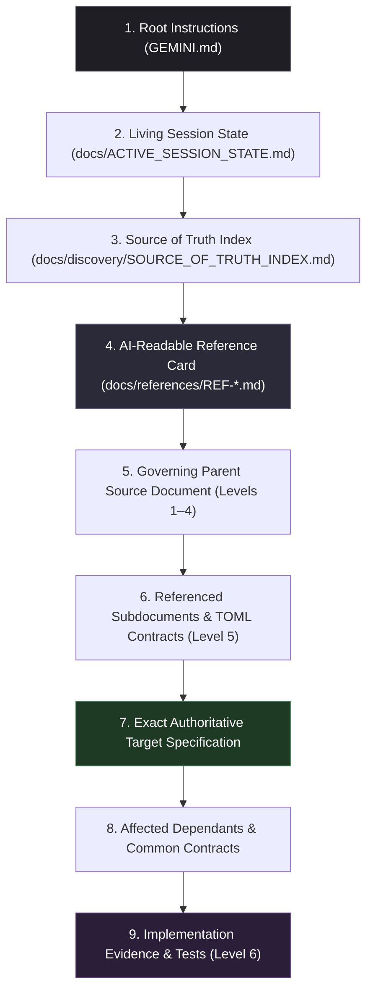

# Document Reference — Binary Sequence Technological Art

> **Document Type:** Project-Wide Documentation Architecture Guide & AI Retrieval Reference  
> **Target Audience:** Project Founders, Systems Architects, Software Engineers, and AI Coding Agents  
> **Canonical Root:** `G:\binarysequence_techart\`  
> **Status:** Active Reference & Navigation Guide (Subordinate to Primary Specifications)  

---

## 1. Introduction

Welcome to **Binary Sequence Technological Art**. This document serves as the master navigation map and operational guide for the studio's documentation-first engineering system.

### Purpose of This Guide
* **For Human Engineers & Founders:** Provides an unambiguous, human-friendly explanation of what documents exist, what each document governs, where each document lives, and how changes propagate across the system.
* **For AI Coding Agents (Antigravity / Gemini):** Defines the exact logical retrieval flow, operational constraints, and verification protocols that must be followed before inspecting code, answering questions, or modifying the repository.

### Foundational Proposition & Core Principles
* **Foundational Proposition:** *"Everyone deserves an enterprise solution."*
* **Engineering Thesis:** *"Complexity should be absorbed by architecture, not transferred to the user."*
* **Studio Ethos:** *"Enterprise engineering. Human experience."*
* **Artifact Character:** Dignity, stillness, structural honesty, mathematical precision, absence of marketing hyperbole.

### The Foundational Precedence Principle
In this repository:
> **Philosophy and approved strategy govern architecture; architecture governs contracts; contracts govern code.**

Code is evidence of current runtime behavior, not an override of approved requirements. When code and requirements diverge, the requirements govern, and the discrepancy must be formally investigated.

---

## 2. How the Documentation System Works

Authority in this project is not determined by file size, git recency, or arbitrary directory names. It is governed by an intentional **6-Level Precedence Hierarchy** and an operational **Dual Markdown + TOML Model**.

### 2.1 The 6-Level Precedence Hierarchy

```text
┌────────────────────────────────────────────────────────────────────────┐
│ LEVEL 1: FOUNDATIONAL STRATEGY & IDENTITY (Read-only, immutable)       │
│ - initial thought and plan.md                                          │
│ - foundational identity, founder website vision & strategic playbook   │
│ - Binary_Sequence_Technological_Art_Final_Master_v1.1.md               │
└───────────────────────────────────┬────────────────────────────────────┘
                                    │ Governs
                                    ▼
┌────────────────────────────────────────────────────────────────────────┐
│ LEVEL 2: AUDIENCE-FACING CONTENT SPECIFICATIONS                        │
│ - audience_facing_content_specification_v1_1.md                        │
│   (Supersedes Binary_Sequence_Audience_Content_Specification_v1.0.md)  │
└───────────────────────────────────┬────────────────────────────────────┘
                                    │ Dictates
                                    ▼
┌────────────────────────────────────────────────────────────────────────┐
│ LEVEL 3: INFORMATION ARCHITECTURE, VIEWPORT & SENSORY CONTRACTS        │
│ - Binary_Sequence_Information_Architecture_v2.0.md                     │
│   (Supersedes Binary_Sequence_Information_Architecture_v1.0.md)        │
│ - binary_sequence_screen_layout_ia_motion_loading_contract_final.md    │
└───────────────────────────────────┬────────────────────────────────────┘
                                    │ Informs
                                    ▼
┌────────────────────────────────────────────────────────────────────────┐
│ LEVEL 4: ARCHITECTURAL METHODOLOGY & BOUNDARIES (DDD)                  │
│ - Binary_Sequence_DDD_Architectural_Methodological_Guidelines_v1.0.md  │
└───────────────────────────────────┬────────────────────────────────────┘
                                    │ Constrains
                                    ▼
┌────────────────────────────────────────────────────────────────────────┐
│ LEVEL 5: MACHINE-READABLE CONTRACTS & SCHEMAS                          │
│ - Approved *.toml contracts & *.schema.json definitions                │
│   (docs/contracts/, src/**/docs/, ai_contract_bootstrap/docs/)         │
└───────────────────────────────────┬────────────────────────────────────┘
                                    │ Verifies
                                    ▼
┌────────────────────────────────────────────────────────────────────────┐
│ LEVEL 6: IMPLEMENTATION & RUNTIME EVIDENCE                             │
│ - Actual source code, test suites, builds, and measured telemetry      │
└────────────────────────────────────────────────────────────────────────┘
```

### 2.2 The Dual Markdown + TOML Model

To eliminate ambiguities between human creative intent and automated machine validation, the repository pairs human-readable Markdown with machine-readable TOML:

1. **Markdown (`.md`) is Authoritative for Rationale and Context:**  
   Contains philosophical context, narrative tone, trade-off evaluations, visual pacing descriptions, and human rationale. Humans author and edit Markdown to express vision and architectural decisions.
2. **TOML (`.toml`) is Authoritative for Machine Facts and Contracts:**  
   Contains strict key-value definitions: schema versions, feature IDs, state machine transitions, exact token values (hex colors, ms durations, px breakpoints), and validation rules. Automated CI scripts validate TOML files against JSON Schemas (`docs/schemas/*.schema.json`).
3. **Synchronization Rule:** TOML contracts must conform strictly to the governing Markdown specifications. If a TOML file and its governing Markdown specification diverge, the Markdown specification governs, and the TOML contract must be corrected.

### 2.3 Implementation vs. Requirement Invariant
* Actual application implementation is evidence of what the software currently does; **it does not automatically override an approved requirement.**
* When implementation and requirements disagree, the agent records the discrepancy in `docs/contracts/DISCREPANCY_REGISTER.md` (or active session state) and seeks founder resolution rather than silently treating either side as universally authoritative.

---

## 3. Documentation Directory Map

The canonical repository (`G:\binarysequence_techart\`) is structured into distinct, non-overlapping directory trees:

```text
G:\binarysequence_techart\
├── GEMINI.md                                    # Root AI operational instructions (auto-loaded)
├── AGENTS.md                                    # Compatibility pointer directing agents to GEMINI.md
├── .gitignore                                   # Conservative repository ignore rules
│
├── [Foundational Level 1 Documents]             # Read-only strategic canons (Root)
│   ├── initial thought and plan.md
│   ├── foundational identity... version 1.0.0.md
│   └── Binary_Sequence_Technological_Art_Final_Master_v1.1.md
│
├── [Approved Level 2–4 Specifications]          # Primary specifications (Root)
│   ├── audience_facing_content_specification_v1_1.md
│   ├── Binary_Sequence_Information_Architecture_v2.0.md
│   ├── binary_sequence_screen_layout_ia_motion_loading_contract_final.md
│   └── Binary_Sequence_DDD_Architectural_Methodological_Guidelines_v1.0.md
│
├── docs/                                        # Living Project Documentation
│   ├── DOCUMENT_REFERENCE.md                    # This document (Master navigation guide)
│   ├── OPERATIONAL_MASTER_BLUEPRINT.md          # Synthesized master blueprint & development flow
│   ├── ACTIVE_SESSION_STATE.md                  # Living ledger of phase, tasks, commits & handoffs
│   │
│   ├── discovery/                               # Phase 0 Audit & Assessment Reports (Historical)
│   │   ├── WORKSPACE_DISCOVERY_REPORT.md
│   │   ├── SOURCE_OF_TRUTH_INDEX.md             # Precedence mapping & asset inventory
│   │   ├── REQUIREMENTS_AND_DISCREPANCIES.md   # Baseline requirement discrepancy register
│   │   ├── BOOTSTRAP_ASSESSMENT.md              # Technical assessment of bootstrap package
│   │   ├── DEVELOPMENT_READINESS_CHECKLIST.md   # DR-01 through DR-10 pre-flight sign-off matrix
│   │   ├── DOCUMENTATION_SYSTEM_AND_AI_PROTOCOL.md # Protocol, decision schema & test procedure
│   │   └── CANONICAL_WORKSPACE_AND_GIT_BASELINE_REPORT.md # Initial Git baseline audit
│   │
│   ├── references/                              # High-Density AI-Readable Reference Cards
│   │   ├── REF-01-FINAL-MASTER-v1.1.md          # Level 1 Strategy summary card
│   │   ├── REF-02-CONTENT-SPEC-v1.1.md          # Level 2 Content & editorial card
│   │   ├── REF-03-IA-AND-LAYOUT-CONTRACT.md     # Level 3 Sitemap, viewport & motion card
│   │   └── REF-04-DDD-ARCHITECTURE.md           # Level 4 Clean architecture & boundary card
│   │
│   └── specifications/                          # Preserved Sub-Specifications
│       ├── common_shared/                       # Common design, interaction & motion spec
│       ├── core_app/                            # Core app shell layout & routing spec
│       └── features/                            # Individual feature screens contract
│
├── ai_contract_bootstrap/                       # Pilot Contract & Validation Package (Candidate)
│   ├── package.scripts.fragment.json
│   ├── README.md
│   ├── scripts/                                 # Verification scripts (specs, tokens, boundaries)
│   ├── docs/                                    # System architecture, protocol & design TOMLs
│   ├── docs/schemas/                            # Formal JSON schemas validating TOML contracts
│   └── src/                                     # Pilot app shell & onboarding contracts
│
└── src/                                         # Application Source Tree
    ├── app/docs/                                # App shell layout & routing contracts
    ├── core/docs/                               # Common shared design & interaction contracts
    └── features/                                # Feature Bounded Contexts
        ├── home/docs/                           # Home feature spec & contracts
        └── onboarding/docs/                     # Onboarding feature spec & contracts
```

---

## 4. Document Catalogue

Every important document across the repository is detailed below with its complete 9-field specification:

### 4.1 Root Instructions and Configuration

#### 1. `GEMINI.md`
* **Relative Path:** `GEMINI.md`
* **Precedence Level:** Operational Governance / Agent Root Instructions
* **Purpose:** Acts as the primary operational protocol, boundaries, retrieval flow, and execution standard for all Gemini and Antigravity AI coding sessions in this repository.
* **Governing Topics:** Canonical workspace boundaries, source-of-truth precedence hierarchy, parent-to-target retrieval sequence, change classification (8 categories), long-prompt & complex task protocol, session continuity.
* **Upstream Documents:** Governed by Level 1 Master Strategy principles.
* **Downstream Documents:** Dictates rules to `AGENTS.md`, `docs/ACTIVE_SESSION_STATE.md`, all AI session behaviors, and code inspection patterns.
* **Status:** `Approved` / Active Governance
* **Key Invariants / Directives:**
  * Zero operations outside `G:\binarysequence_techart\`.
  * Precedence Principle: Philosophy governs architecture; architecture governs contracts; contracts govern code.
  * Code is evidence of runtime behavior, not an override of requirements.
  * No-Unnecessary-Documents Rule: Update existing authoritative files in place; never create parallel competing documents.

#### 2. `AGENTS.md`
* **Relative Path:** `AGENTS.md`
* **Precedence Level:** Operational Governance / Agent Root Pointer
* **Purpose:** Compatibility pointer directing external agents, alternate AI assistants, and IDE extensions to `GEMINI.md`.
* **Governing Topics:** Agent direction and compatibility forwarding.
* **Upstream Documents:** Governed by `GEMINI.md`.
* **Downstream Documents:** All third-party or IDE tooling reading standard agent guidance.
* **Status:** `Approved` / Active Reference
* **Key Invariants / Directives:**
  * Must remain synchronized with `GEMINI.md`.
  * Forwards all authority and retrieval instructions to `GEMINI.md`.

#### 3. `.gitignore`
* **Relative Path:** `.gitignore`
* **Precedence Level:** Operational Governance / Repository File Filter
* **Purpose:** Conservative repository ignore rules protecting sensitive, generated, or transient files from entering source control.
* **Governing Topics:** Git tracking boundaries, dependency exclusions (`node_modules/`, `.pnpm-store/`), secrets (`.env*`, `*.pem`), build artifacts (`dist/`, `.astro/`), and temporary execution files (`*.tmp`).
* **Upstream Documents:** Governed by `docs/discovery/CANONICAL_WORKSPACE_AND_GIT_BASELINE_REPORT.md` and repository administration standards.
* **Downstream Documents:** Protects entire Git repository tree.
* **Status:** `Approved` / Active Configuration
* **Key Invariants / Directives:**
  * Excludes `Binary_Sequence_AI_Development_Contract_System_v1.0_bootstrap.zip`.
  * Excludes temporary execution files matching `*.tmp` (e.g. `.task_<name>.tmp`).
  * Strict prohibition on tracking secrets, certificates, or local environment configurations.

---

### 4.2 Foundational Strategy Documents (Level 1)

#### 4. `initial thought and plan.md`
* **Relative Path:** `initial thought and plan.md`
* **Precedence Level:** Level 1 — Foundational Strategy & Originating Vision (Immutable)
* **Purpose:** Captures the founder's raw originating convictions, personal background, and foundational inspiration.
* **Governing Topics:** Founder identity (Akshay Kumar V J), foundational proposition ("Everyone deserves an enterprise solution"), studio ethos, nomadic engineering clarity.
* **Upstream Documents:** Originating document (None).
* **Downstream Documents:** Informs `foundational identity... v1.0.0.md` and `Binary_Sequence_Technological_Art_Final_Master_v1.1.md`.
* **Status:** `Immutable` / Historical Anchor (`[DO NOT EDIT: ORIGINL HUMAN CONTENT]`)
* **Key Invariants / Directives:**
  * Must never be edited, rewritten, or deleted.
  * Expresses aspirational lifecycle horizon ("5 to 15 years") and personal studio vision.

#### 5. `foundational identity, founder website vision & strategic playbook - version 1.0.0.md`
* **Relative Path:** `foundational identity, founder website vision & strategic playbook - version 1.0.0.md`
* **Precedence Level:** Level 1 — Foundational Strategy (Immutable)
* **Purpose:** 53-section foundational canon defining the studio's meaning, philosophy, founder profile, initial 7-product ecosystem, and commercial models.
* **Governing Topics:** Core philosophy ("Complexity should be absorbed by architecture"), Swiss laboratory visual metaphor, 7 products/platforms, initial website narrative.
* **Upstream Documents:** Governed by `initial thought and plan.md`.
* **Downstream Documents:** Informs `Binary_Sequence_Technological_Art_Final_Master_v1.1.md`.
* **Status:** `Immutable` / Strategic Canon (`[DO NOT EDIT: ORIGINAL INITIAL DEFINITION]`)
* **Key Invariants / Directives:**
  * Must never be edited, rewritten, or deleted.
  * Sections 1–53 are fully preserved and canonized in Master v1.1.

#### 6. `Binary_Sequence_Technological_Art_Final_Master_v1.1.md`
* **Relative Path:** `Binary_Sequence_Technological_Art_Final_Master_v1.1.md`
* **Precedence Level:** Level 1 — Definitive Strategic Master (Highest Strategic Authority)
* **Purpose:** Definitive strategic master document for the studio. Preserves Sections 1–53 and introduces Sections 54–77 (Parts XI–XIV) establishing 17 formal changes, evidence gates, and operating constraints.
* **Governing Topics:** Practice vs. Product separation, Sequence Core platform, Sequence Blueprint discovery phase, 3-layer 5–15 year horizon model, client capacity constraints (max 2 active engagements), 3-generation website evolution, 9-step execution order (Website V1 is Step 3), Minimum Appropriate Technology (MAT) rule.
* **Upstream Documents:** Governed by originating Level 1 vision documents.
* **Downstream Documents:** Directly governs all Level 2–6 specifications, contracts, and code.
* **Status:** `Approved` / Definitive Strategic Canon
* **Key Invariants / Directives:**
  * Highest strategic authority in the project; overrides conflicting statements in earlier drafts.
  * Website V1 is the "First Public Technological Artifact" (Practice surface), not "Product #01".
  * Minimum Appropriate Technology Rule: Technology stack must be chosen based on minimal complexity and stability, not agency hype.
  * Operating Capacity Rule: Strict limit of 2 concurrent client engagements to protect research and founder focus.

---

### 4.3 Approved Specifications (Levels 2–4)

#### 7. `audience_facing_content_specification_v1_1.md`
* **Relative Path:** `audience_facing_content_specification_v1_1.md`
* **Precedence Level:** Level 2 — Audience-Facing Content Specifications
* **Purpose:** Definitive editorial contract and audience-facing copy specification for the studio website.
* **Governing Topics:** Two-Tier Discovery Model (Tier 1 Commercial Pragmatism vs. Tier 2 Deep Exploratory Research), 7 Invariant Editorial Rules, exact verbatim screen copy, typography hierarchy, reading rhythm.
* **Upstream Documents:** Governed by `Binary_Sequence_Technological_Art_Final_Master_v1.1.md`.
* **Downstream Documents:** Dictates copy to `Binary_Sequence_Information_Architecture_v2.0.md`, feature specifications, and UI components.
* **Status:** `Approved` / Authoritative Content Specification (Supersedes v1.0 draft)
* **Key Invariants / Directives:**
  * 7 Invariant Editorial Rules: Truth now, complexity absorption, eliminate speculative guarantees, 5–15 yr planning vs unlimited warranty, continuity protocol, evidence before metrics, two-scroll scannability.
  * Verbatim screen copy for all 10 public views is mandatory; UI components must not alter approved text.

#### 8. `Binary_Sequence_Information_Architecture_v2.0.md`
* **Relative Path:** `Binary_Sequence_Information_Architecture_v2.0.md`
* **Precedence Level:** Level 3 — Information Architecture & Structural Baseline
* **Purpose:** Approved site hierarchy, route taxonomy, navigation architecture, and low-fidelity ASCII wireframes for all public screens.
* **Governing Topics:** 10-screen sitemap (6 Tier 1 screens, 4 Tier 2 screens, plus utility routes `/privacy`, `/service-boundaries`, `/404`), URL taxonomy, header/footer matrices, ASCII wireframe layouts, 4-part wireframe review checklist.
* **Upstream Documents:** Governed by Level 1 Master v1.1 and Level 2 Content Spec v1.1.
* **Downstream Documents:** Informs layout contracts, routing contracts (`APP_SHELL_LAYOUT_ROUTING_CONTRACT.toml`), and UI page implementations.
* **Status:** `Approved` / Authoritative IA Specification (Supersedes v1.0 draft)
* **Key Invariants / Directives:**
  * Sole approved public contact email is `binarysequence.techart@gmail.com`.
  * "System Verification Register" is formally deferred from V1 launch and excluded from sitemap/navigation.
  * 10 approved screens: Home (`/`), Studio (`/studio`), Products & Systems (`/products-systems`), Sequence Method (`/method`), Sequence Blueprint (`/sequence-blueprint`), Contact (`/contact`), Engineering & Field Notebook (`/field-notebook`), Research & Experiments (`/research`), Founder Practice (`/founder`), Continuity & Trust (`/continuity`).

#### 9. `binary_sequence_screen_layout_ia_motion_loading_contract_final.md`
* **Relative Path:** `binary_sequence_screen_layout_ia_motion_loading_contract_final.md`
* **Precedence Level:** Level 3 — Global Design, Viewport, Layout, Motion, Layout Science & Content Reveal Contract
* **Purpose:** Binding contractual specifications for responsive viewports, layout grids, typography scales, dark-surface ergonomics, layout science (Gestalt principles), color psychology, physics-based motion, progressive disclosure, non-disruptive overlay hierarchy, and loading system states.
* **Governing Topics:** 5 responsive viewports, 8pt spatial grid, Gestalt principles (Proximity, Similarity, Continuity, Closure, Focal Point, Figure-Ground), neural processing ergonomics (foveal 4:3 frame, Cowan's chunk limit, Hick's Law), color psychology (Obsidian Carbon, Warm Alabaster, Signal Amber, circadian ergonomics, 60-30-10 distribution), contrast ratios (WCAG AAA for body text), GPU-composited motion (opacity/transform only), non-disruptive progressive disclosure (in-situ expansion, side drawer vs modal semantics, focus trapping, `inert` attribute, zero arbitrary popups), natural easing curves, loading state tiers (<100ms, <300ms, >1s), 8-state component lifecycle.
* **Upstream Documents:** Governed by Level 1 Master v1.1, Level 2 Content Spec v1.1, and Level 3 IA v2.0.
* **Downstream Documents:** Directly governs `docs/references/REF-03-IA-AND-LAYOUT-CONTRACT.md`, `GLOBAL_DESIGN_SYSTEM.toml`, CSS stylesheets, and presentation components.
* **Status:** `Approved` / Binding Sensory, Perceptual & Layout Contract
* **Key Invariants / Directives:**
  * 5 Viewport Breakpoints: Mobile Portrait (360–428px), Landscape Mobile (568–844px), Tablet (768–1024px), Desktop (1280–1440px), Widescreen/Ultra-Wide (1536–2560px+).
  * Strict reduced-motion support (`prefers-reduced-motion: reduce`) disables physics transitions.
  * Motion is restricted to GPU-composited properties (`transform`, `opacity`); no layout-triggering properties (`width`, `height`, `top`).
  * Layout science and Gestalt proximity/similarity/continuity laws govern all spatial relationships.
  * Color psychology and circadian ergonomics mandate obsidian carbon ground with zero pure black `#000000` halation.
  * Zero unsolicited promotional popups or jarring modal takeovers; non-disruptive progressive disclosure with focus restoration.

#### 10. `Binary_Sequence_DDD_Architectural_Methodological_Guidelines_v1.0.md`
* **Relative Path:** `Binary_Sequence_DDD_Architectural_Methodological_Guidelines_v1.0.md`
* **Precedence Level:** Level 4 — Architectural Methodology & Boundaries
* **Purpose:** Architectural standard establishing feature-first modularity informed by Domain-Driven Design (DDD), 4-layer clean architecture, shared kernel boundaries, and an 8-sprint feature lifecycle.
* **Governing Topics:** 4 clean architecture layers (`domain/`, `application/`, `infrastructure/`, `presentation/`), strict module boundaries (zero cross-feature imports, public gateways only via `index.ts`), shared kernel discipline, 11 proposed bounded contexts, 8-sprint feature progression gates, Section 16 Engineering Constitution (SOLID principles, 10-step component reuse, Sequence Core rules, data ownership/validation/error boundaries, 15 Quality Gates ARCH-01 through ARCH-15).
* **Upstream Documents:** Governed by Level 1 Master v1.1, Level 2 Content Spec v1.1, and Level 3 IA v2.0.
* **Downstream Documents:** Informs Level 5 machine contracts (`CORE_GATEWAY_CONTRACTS.toml`, `FEATURE_SPEC.toml`) and directory layout in `src/`.
* **Status:** `Approved` / Architectural Framework (Target architecture; does not imply code exists)
* **Key Invariants / Directives:**
  * Strict Public Gateway Boundary: Features never import internal files of other features; all cross-feature communication occurs via public gateways.
  * Dependency Inversion: Domain layer has zero external dependencies; Application layer orchestrates; Infrastructure implements ports; Presentation handles view logic.
  * Engineering Constitution: SOLID compliance, evidence-based component reuse without cross-feature domain leakage, and mandatory ARCH-01 through ARCH-15 quality gate evaluations.

---

### 4.4 Preserved Sub-Specifications (`docs/specifications/`)

#### 11. `docs/specifications/common_shared/COMMON_SHARED_DESIGN_INTERACTION_AND_MOTION_CONTRACT.md`
* **Relative Path:** `docs/specifications/common_shared/COMMON_SHARED_DESIGN_INTERACTION_AND_MOTION_CONTRACT.md`
* **Precedence Level:** Level 3 Subordinate Specification
* **Purpose:** Preserved detailed contract specifying common shared interaction tokens, accessibility focus rings, and component motion timings.
* **Governing Topics:** Shared component interactions, hover states, keyboard navigation focus indicators, common transitions.
* **Upstream Documents:** Governed by `binary_sequence_screen_layout_ia_motion_loading_contract_final.md`.
* **Downstream Documents:** Informs `src/core/docs/COMMON_SHARED_DESIGN_INTERACTION_CONTRACT.toml` and shared UI components.
* **Status:** `Approved` / Preserved Sub-Specification
* **Key Invariants / Directives:**
  * Shared interaction primitives must remain decoupled from specific feature domains.

#### 12. `docs/specifications/core_app/CORE_APP_SHELL_LAYOUT_AND_ROUTING_CONTRACT.md`
* **Relative Path:** `docs/specifications/core_app/CORE_APP_SHELL_LAYOUT_AND_ROUTING_CONTRACT.md`
* **Precedence Level:** Level 3/4 Subordinate Specification
* **Purpose:** Preserved detailed contract specifying the core application shell layout grid, header/footer wrappers, and client routing lifecycle.
* **Governing Topics:** App shell layout container, responsive outer wrappers, navigation state orchestration.
* **Upstream Documents:** Governed by IA v2.0 and Layout Contract Final.
* **Downstream Documents:** Informs `src/app/docs/APP_SHELL_LAYOUT_ROUTING_CONTRACT.toml`.
* **Status:** `Approved` / Preserved Sub-Specification
* **Key Invariants / Directives:**
  * Outer shell must absorb responsive layout variations without child component layout thrashing.

#### 13. `docs/specifications/features/INDIVIDUAL_FEATURE_SCREENS_AND_INTERACTION_CONTRACT.md`
* **Relative Path:** `docs/specifications/features/INDIVIDUAL_FEATURE_SCREENS_AND_INTERACTION_CONTRACT.md`
* **Precedence Level:** Level 3/4 Subordinate Specification
* **Purpose:** Preserved contract detailing feature-level interaction schemas, CTA transitions, and state lifecycles across screens.
* **Governing Topics:** Feature interaction contracts, viewmodel bindings, screen state transitions.
* **Upstream Documents:** Governed by Content Spec v1.1, IA v2.0, and DDD Guidelines v1.0.
* **Downstream Documents:** Informs `src/features/**/docs/FEATURE_SPEC.toml`.
* **Status:** `Approved` / Preserved Sub-Specification
* **Key Invariants / Directives:**
  * Feature screens must consume shared design tokens rather than defining custom ad-hoc styling primitives.

---

### 4.5 AI-Readable Associative Reference Cards (`docs/references/`)

#### 14. `docs/references/REF-01-FINAL-MASTER-v1.1.md`
* **Relative Path:** `docs/references/REF-01-FINAL-MASTER-v1.1.md`
* **Precedence Level:** Level 1 Reference Card
* **Purpose:** High-density, token-efficient reference card summarizing the definitive Master Strategy v1.1 for rapid AI ingestion.
* **Governing Topics:** 17 formal changes, 3-layer 5–15 yr horizon, Minimum Appropriate Technology rule, 9-step execution order, operating capacity constraints.
* **Upstream Documents:** Governed by `Binary_Sequence_Technological_Art_Final_Master_v1.1.md`.
* **Downstream Documents:** Informs AI context loading and rapid strategy verification.
* **Status:** `Reference` / Active Reference Card
* **Key Invariants / Directives:**
  * Subordinate navigation aid; primary document governs if textual nuance is needed.
  * Synchronized whenever Master v1.1 is updated.

#### 15. `docs/references/REF-02-CONTENT-SPEC-v1.1.md`
* **Relative Path:** `docs/references/REF-02-CONTENT-SPEC-v1.1.md`
* **Precedence Level:** Level 2 Reference Card
* **Purpose:** High-density reference card summarizing the Two-Tier discovery model, 7 invariant editorial rules, verbatim copy structure, and contact resolutions.
* **Governing Topics:** Two-tier model, 7 editorial rules, hero copy, contact email (`binarysequence.techart@gmail.com`).
* **Upstream Documents:** Governed by `audience_facing_content_specification_v1_1.md`.
* **Downstream Documents:** Informs AI content reviews and copy verification.
* **Status:** `Reference` / Active Reference Card
* **Key Invariants / Directives:**
  * Summarizes editorial invariants without loading 48 KB of prose.

#### 16. `docs/references/REF-03-IA-AND-LAYOUT-CONTRACT.md`
* **Relative Path:** `docs/references/REF-03-IA-AND-LAYOUT-CONTRACT.md`
* **Precedence Level:** Level 3 Reference Card
* **Purpose:** High-density reference card synthesizing IA v2.0 sitemap with the Global Layout, Viewport, Motion, Layout Science, Color Psychology & Content Reveal Contract.
* **Governing Topics:** 10 approved screens, deferred register, 5 breakpoints, 8pt spatial grid, Gestalt principles, color psychology (Obsidian Carbon ground), non-disruptive progressive disclosure, drawer vs modal semantics, contrast ratios, GPU motion rules, loading latency thresholds.
* **Upstream Documents:** Governed by `Binary_Sequence_Information_Architecture_v2.0.md` and `binary_sequence_screen_layout_ia_motion_loading_contract_final.md`.
* **Downstream Documents:** Informs UI layout, sensory ergonomics, and styling validation.
* **Status:** `Reference` / Active Reference Card
* **Key Invariants / Directives:**
  * Combines IA, sensory layout constraints, Gestalt principles, and overlay hierarchy into a single rapid lookup card.

#### 17. `docs/references/REF-04-DDD-ARCHITECTURE.md`
* **Relative Path:** `docs/references/REF-04-DDD-ARCHITECTURE.md`
* **Precedence Level:** Level 4 Reference Card
* **Purpose:** High-density reference card summarizing Domain-Driven Design layering, module boundaries, shared kernel rules, and 8-sprint gates.
* **Governing Topics:** 4 clean architecture layers, public gateway isolation, dependency direction, 8-sprint feature lifecycle.
* **Upstream Documents:** Governed by `Binary_Sequence_DDD_Architectural_Methodological_Guidelines_v1.0.md`.
* **Downstream Documents:** Informs module structure and architectural compliance checks.
* **Status:** `Reference` / Active Reference Card
* **Key Invariants / Directives:**
  * Enforces zero internal cross-feature imports.

---

### 4.6 Discovery Reports & Ledgers (`docs/discovery/` & `docs/`)

#### 18. `docs/OPERATIONAL_MASTER_BLUEPRINT.md`
* **Relative Path:** `docs/OPERATIONAL_MASTER_BLUEPRINT.md`
* **Precedence Level:** Operational Governance / Permanent Master Blueprint
* **Purpose:** Synthesized master blueprint, engineering constitution, and permanent development lifecycle across all phases.
* **Governing Topics:** Five foundational axioms, 6-level precedence hierarchy, dual Markdown/TOML model, 13-step AI development lifecycle (Mermaid diagram), Engineering Constitution (SOLID, DDD, component reuse, Sequence Core rules, ARCH-01 to ARCH-15 quality gates, anti-patterns), pre-flight readiness status.
* **Upstream Documents:** Governed by Master v1.1, Content Spec v1.1, IA v2.0, Layout Contract Final, DDD Guidelines v1.0, `GEMINI.md`.
* **Downstream Documents:** Directs all ongoing and future AI development sessions across the studio.
* **Status:** `Approved` / Master Blueprint
* **Key Invariants / Directives:**
  * Permanent binding commitment across all sessions.
  * Zero operations outside `G:\binarysequence_techart\`.
  * Mandatory evaluation of 15 Architectural Quality Gates (ARCH-01 through ARCH-15).

#### 19. `docs/ACTIVE_SESSION_STATE.md`
* **Relative Path:** `docs/ACTIVE_SESSION_STATE.md`
* **Precedence Level:** Operational Governance / Living Session Ledger
* **Purpose:** Living ledger tracking current project phase, active tasks, core decisions, commit history, tooling status, and handoff notes across AI sessions.
* **Governing Topics:** Session continuity, phase progression, active blockers (`DR-02`), pending decisions (`DR-03`, `DR-04`, `DR-08`), completed work records.
* **Upstream Documents:** Governed by `GEMINI.md` Section 10.
* **Downstream Documents:** Consulted at the start of every session; updated at the conclusion of every task.
* **Status:** `Living` / Active Operational Ledger
* **Key Invariants / Directives:**
  * Maintained in-place; never create duplicate or versioned handoff files.
  * Records empirical commit hashes and test evidence.

#### 19. `docs/discovery/SOURCE_OF_TRUTH_INDEX.md`
* **Relative Path:** `docs/discovery/SOURCE_OF_TRUTH_INDEX.md`
* **Precedence Level:** Level 4 Governance / Precedence Index
* **Purpose:** Comprehensive precedence mapping, asset assessment matrix, and reference card index across all repository documents.
* **Governing Topics:** Precedence hierarchy (Levels 1–6), document status mapping, conflict resolutions, reference card catalog.
* **Upstream Documents:** Governed by foundational documents and repository audit.
* **Downstream Documents:** Guides parent-to-target retrieval for AI sessions.
* **Status:** `Approved` / Active Governance
* **Key Invariants / Directives:**
  * Defines the formal 6-level precedence ranking.

#### 20. `docs/discovery/DOCUMENTATION_SYSTEM_AND_AI_PROTOCOL.md`
* **Relative Path:** `docs/discovery/DOCUMENTATION_SYSTEM_AND_AI_PROTOCOL.md`
* **Precedence Level:** Level 4 Governance / Operational Protocol
* **Purpose:** Formalizes the dual Markdown/TOML documentation system, decision registry schema, 7-phase execution workflow, and 6-point fresh-session test procedure.
* **Governing Topics:** Markdown/TOML roles, 7 execution phases (A through G), decision record format (`EDR`), change classification vocabulary, empirical test procedure.
* **Upstream Documents:** Governed by Master v1.1 and `GEMINI.md`.
* **Downstream Documents:** Dictates task execution standards across all phases.
* **Status:** `Approved` / Active Governance
* **Key Invariants / Directives:**
  * Mandates empirical verification before declaring any task complete.

#### 21. `docs/discovery/DEVELOPMENT_READINESS_CHECKLIST.md`
* **Relative Path:** `docs/discovery/DEVELOPMENT_READINESS_CHECKLIST.md`
* **Precedence Level:** Level 4 Governance / Pre-Flight Gate
* **Purpose:** Tracks 10 formal readiness items (`DR-01` through `DR-10`) that must be signed off before beginning application feature coding.
* **Governing Topics:** Pre-implementation sign-offs: workspace confirmation, toolchain verification, stack selection, scope boundaries, contact intake, design tokens.
* **Upstream Documents:** Governed by Master v1.1 Change 14 & 16 (Evidence Gates).
* **Downstream Documents:** Gates Phase 1 application implementation.
* **Status:** `Approved` / Active Gate Matrix
* **Key Invariants / Directives:**
  * Implementation cannot commence while `DR-02` (tooling) and `DR-03` (stack) remain unresolved.

#### 22. `docs/discovery/REQUIREMENTS_AND_DISCREPANCIES.md`
* **Relative Path:** `docs/discovery/REQUIREMENTS_AND_DISCREPANCIES.md`
* **Precedence Level:** Level 4 Historical Discovery Report
* **Purpose:** Records baseline discrepancies discovered between early draft specifications and finalized master documents.
* **Governing Topics:** Historical discrepancies: contact emails, system verification register deferral, onboarding gate scope.
* **Upstream Documents:** Governed by Phase 0 discovery audit.
* **Downstream Documents:** Informs active decisions table in `docs/ACTIVE_SESSION_STATE.md`.
* **Status:** `Historical` / Discovery Baseline
* **Key Invariants / Directives:**
  * Historical audit record; preserved for governance integrity.

#### 23. `docs/discovery/BOOTSTRAP_ASSESSMENT.md`
* **Relative Path:** `docs/discovery/BOOTSTRAP_ASSESSMENT.md`
* **Precedence Level:** Level 4 Technical Assessment
* **Purpose:** Comprehensive technical audit and adoption recommendation for the pilot contracts in `ai_contract_bootstrap/`.
* **Governing Topics:** Evaluation of pilot TOML contracts, JSON schemas, validation scripts, and technology stack recommendations (Astro recommendation).
* **Upstream Documents:** Evaluates `ai_contract_bootstrap/`.
* **Downstream Documents:** Informs `DEC-006` and future contract migration.
* **Status:** `Approved` / Discovery Report
* **Key Invariants / Directives:**
  * Recommends adopting TOML contracts while decoupling from Next.js assumptions.

#### 24. `docs/discovery/CANONICAL_WORKSPACE_AND_GIT_BASELINE_REPORT.md`
* **Relative Path:** `docs/discovery/CANONICAL_WORKSPACE_AND_GIT_BASELINE_REPORT.md`
* **Precedence Level:** Level 4 Historical Audit Report
* **Purpose:** Documents the empirical verification of `G:\binarysequence_techart\` as the sole canonical repository and records the initial Git baseline creation.
* **Governing Topics:** Canonical root confirmation, SHA-256 hash comparison between former workspaces, Git repository initialization evidence.
* **Upstream Documents:** Originating workspace comparison audit.
* **Downstream Documents:** Recorded initial Git commits `a047c2d` and `3c15797`.
* **Status:** `Historical` / Audit Baseline
* **Key Invariants / Directives:**
  * Confirms permanent elimination of `G:\binarysequence_technologicalart\`.

#### 25. `docs/discovery/WORKSPACE_DISCOVERY_REPORT.md`
* **Relative Path:** `docs/discovery/WORKSPACE_DISCOVERY_REPORT.md`
* **Precedence Level:** Level 4 Historical Discovery Report
* **Purpose:** Initial inventory and structural discovery report of files and directories across the candidate workspaces.
* **Governing Topics:** Initial file list, metadata inspection, structural findings.
* **Upstream Documents:** Phase 0 initial discovery.
* **Downstream Documents:** Preceded `CANONICAL_WORKSPACE_AND_GIT_BASELINE_REPORT.md`.
* **Status:** `Historical` / Discovery Baseline
* **Key Invariants / Directives:**
  * Preserved historical evidence of initial state.

---

### 4.7 Bootstrap Package Assets (`ai_contract_bootstrap/`)

#### 26. `ai_contract_bootstrap/docs/ARCHITECTURE_INDEX.toml`
* **Relative Path:** `ai_contract_bootstrap/docs/ARCHITECTURE_INDEX.toml`
* **Precedence Level:** Level 5 Machine Contract (Candidate)
* **Purpose:** Machine-readable catalog mapping system layers, bounded feature contexts, route mappings, and export interfaces.
* **Governing Topics:** Context IDs (`FEAT-01-ONB` through `FEAT-11-TRST`), route paths, ownership metadata.
* **Upstream Documents:** Governed by DDD Guidelines v1.0 and IA v2.0.
* **Downstream Documents:** Validated by `architecture-index.schema.json` via `validate-specs.mjs`.
* **Status:** `Proposed` / Candidate Contract
* **Key Invariants / Directives:**
  * Defines formal machine IDs for automated boundary validation scripts.

#### 27. `ai_contract_bootstrap/docs/GLOBAL_DESIGN_SYSTEM.toml`
* **Relative Path:** `ai_contract_bootstrap/docs/GLOBAL_DESIGN_SYSTEM.toml`
* **Precedence Level:** Level 5 Machine Contract (Candidate)
* **Purpose:** Machine-readable design system tokens including color palettes, typography primitives, spacing units, and elevation levels.
* **Governing Topics:** Hex color values, fluid spacing scale, font families, dark-surface opacity tokens.
* **Upstream Documents:** Governed by `binary_sequence_screen_layout_ia_motion_loading_contract_final.md`.
* **Downstream Documents:** Validated by `design-system.schema.json` via `validate-design-tokens.mjs`.
* **Status:** `Proposed` / Candidate Contract
* **Key Invariants / Directives:**
  * Must conform to Level 3 sensory layout contract values.

#### 28. `ai_contract_bootstrap/docs/CORE_GATEWAY_CONTRACTS.toml`
* **Relative Path:** `ai_contract_bootstrap/docs/CORE_GATEWAY_CONTRACTS.toml`
* **Precedence Level:** Level 5 Machine Contract (Candidate)
* **Purpose:** Machine-readable public interface contracts and Data Transfer Objects (DTOs) for cross-feature gateways (e.g. Contact, Sequence Core).
* **Governing Topics:** Gateway method signatures, request/response DTO schemas, error codes.
* **Upstream Documents:** Governed by DDD Guidelines v1.0.
* **Downstream Documents:** Validated by `core-gateway.schema.json`.
* **Status:** `Proposed` / Candidate Contract
* **Key Invariants / Directives:**
  * Enforces public boundary isolation between bounded contexts.

#### 29. `ai_contract_bootstrap/docs/schemas/*.schema.json`
* **Relative Path:** `ai_contract_bootstrap/docs/schemas/` (5 JSON schema definitions)
* **Precedence Level:** Level 5 Validation Schemas
* **Purpose:** Formal JSON Schema (Draft-07) files used by automated scripts to validate TOML contract structure and typing.
* **Governing Topics:** Structural validation of `architecture-index`, `core-gateway`, `design-system`, `feature-spec`, and `ui-wireframe` TOMLs.
* **Upstream Documents:** Governed by Level 4 Architectural Guidelines and Level 3 IA contracts.
* **Downstream Documents:** Consumed by validation scripts in `ai_contract_bootstrap/scripts/`.
* **Status:** `Proposed` / Candidate Schemas
* **Key Invariants / Directives:**
  * Validates required keys, string patterns, enum constraints, and forbidden ad-hoc fields.

#### 30. `ai_contract_bootstrap/scripts/*.mjs`
* **Relative Path:** `ai_contract_bootstrap/scripts/` (4 Node.js validation scripts)
* **Precedence Level:** Level 5 Tooling / Contract Validators
* **Purpose:** Node.js automation scripts verifying TOML validity, token completeness, and feature import boundary isolation.
* **Governing Topics:** Validation execution: `validate-specs.mjs`, `validate-design-tokens.mjs`, `validate-feature-boundaries.mjs`, `generate-docs.mjs`.
* **Upstream Documents:** Governed by `package.scripts.fragment.json` and JSON schemas.
* **Downstream Documents:** Enforces integrity of `src/` and `docs/contracts/`.
* **Status:** `Proposed` / Tooling Scripts (Execution currently blocked by host PATH `DR-02`)
* **Key Invariants / Directives:**
  * Validates that features do not bypass public gateways or use undeclared tokens.

---

### 4.8 Application Shell and Feature Contracts (`src/`)

#### 31. `src/app/docs/APP_SHELL_LAYOUT_ROUTING_CONTRACT.toml`
* **Relative Path:** `src/app/docs/APP_SHELL_LAYOUT_ROUTING_CONTRACT.toml`
* **Precedence Level:** Level 5 Machine Contract (Active)
* **Purpose:** Active machine contract defining application shell layout regions, header/footer wrappers, and client route mapping.
* **Governing Topics:** Route table, shell layout slots (`header`, `main`, `footer`), layout wrapper IDs.
* **Upstream Documents:** Governed by IA v2.0 and `docs/specifications/core_app/`.
* **Downstream Documents:** Directly configures application routing and shell components.
* **Status:** `Approved` / Active Contract
* **Key Invariants / Directives:**
  * All public routes must resolve to approved sitemap paths.

#### 32. `src/core/docs/COMMON_SHARED_DESIGN_INTERACTION_CONTRACT.toml`
* **Relative Path:** `src/core/docs/COMMON_SHARED_DESIGN_INTERACTION_CONTRACT.toml`
* **Precedence Level:** Level 5 Machine Contract (Active)
* **Purpose:** Active machine contract defining shared interaction timing constants, focus outline tokens, and transition physics.
* **Governing Topics:** Interaction timing (`hover_ms`, `focus_ring_width`), common physics curves.
* **Upstream Documents:** Governed by Layout Contract Final and `docs/specifications/common_shared/`.
* **Downstream Documents:** Shared UI components and core primitives.
* **Status:** `Approved` / Active Contract
* **Key Invariants / Directives:**
  * Provides shared tokens consumed by all feature screens.

#### 33. `src/features/home/docs/FEATURE_SPEC.toml`
* **Relative Path:** `src/features/home/docs/FEATURE_SPEC.toml`
* **Precedence Level:** Level 5 Machine Contract (Active)
* **Purpose:** Active machine contract for the Home feature (`/`), defining states, viewmodels, CTA links, and verification criteria.
* **Governing Topics:** Home screen state machine (`INITIAL`, `LOADED`, `DEGRADED`), hero copy bindings, CTA routes.
* **Upstream Documents:** Governed by Content Spec v1.1 and IA v2.0.
* **Downstream Documents:** Directs implementation of Home feature presentation components.
* **Status:** `Approved` / Active Contract
* **Key Invariants / Directives:**
  * Consumes verbatim copy from Content Spec v1.1.

#### 34. `src/features/onboarding/docs/FEATURE_SPEC.md`
* **Relative Path:** `src/features/onboarding/docs/FEATURE_SPEC.md`
* **Precedence Level:** Level 5 Feature Specification (Candidate / Deferred)
* **Purpose:** Preserved pilot specification for the interactive modal Onboarding Gate (`FEAT-01-ONB`).
* **Governing Topics:** Onboarding modal steps, intent questionnaire, client intake gate.
* **Upstream Documents:** Inherited from bootstrap pilot package.
* **Downstream Documents:** Pending decision `DR-04` / `DEC-005`.
* **Status:** `Proposed` / Deferred Feature Spec
* **Key Invariants / Directives:**
  * Currently proposed for deferral in favor of direct landing on Home hero; retained for architectural reference.

---

## 5. Which Documents Does the AI Follow?

When an AI coding agent operates in this workspace, it determines which documents to consult based on the specific category of work. The agent consults documents strictly in the following precedence order:

### 5.1 General Architecture or Strategy Questions
*When answering strategic questions, evaluating business models, client caps, or architectural scope:*
1. [`GEMINI.md`](file:///G:/binarysequence_techart/GEMINI.md) — Confirms operational rules and boundaries.
2. [`docs/ACTIVE_SESSION_STATE.md`](file:///G:/binarysequence_techart/docs/ACTIVE_SESSION_STATE.md) — Confirms active phase, approved decisions, and unresolved questions.
3. [`docs/references/REF-01-FINAL-MASTER-v1.1.md`](file:///G:/binarysequence_techart/docs/references/REF-01-FINAL-MASTER-v1.1.md) — AI reference card for high-density strategic rules.
4. [`Binary_Sequence_Technological_Art_Final_Master_v1.1.md`](file:///G:/binarysequence_techart/Binary_Sequence_Technological_Art_Final_Master_v1.1.md) — Definitive primary strategic canon (Sections 54–77, 17 formal changes).
5. [`foundational identity, founder website vision & strategic playbook - version 1.0.0.md`](file:///G:/binarysequence_techart/foundational%20identity,%20founder%20website%20vision%20&%20strategic%20playbook%20-%20version%201.0.0.md) — Foundational identity and philosophical canon (Sections 1–53).
6. [`initial thought and plan.md`](file:///G:/binarysequence_techart/initial%20thought%20and%20plan.md) — Founder originating brief.

### 5.2 Content or Copy Changes
*When authoring, reviewing, modifying, or rendering user-facing text, page titles, or value pillars:*
1. [`GEMINI.md`](file:///G:/binarysequence_techart/GEMINI.md) — Confirms change classification and boundary rules.
2. [`docs/references/REF-02-CONTENT-SPEC-v1.1.md`](file:///G:/binarysequence_techart/docs/references/REF-02-CONTENT-SPEC-v1.1.md) — AI reference card for 7 editorial rules and Two-Tier model.
3. [`audience_facing_content_specification_v1_1.md`](file:///G:/binarysequence_techart/audience_facing_content_specification_v1_1.md) — Primary authoritative content specification (verbatim screen copy).
4. [`Binary_Sequence_Information_Architecture_v2.0.md`](file:///G:/binarysequence_techart/Binary_Sequence_Information_Architecture_v2.0.md) — Low-fidelity wireframe schematics and route labels.
5. Specific Feature Content Contracts — `src/features/**/docs/FEATURE_SPEC.toml` or `FEATURE_SPEC.md`.

### 5.3 UI, Layout, Motion, or Sensory Changes
*When creating or altering responsive viewports, CSS styles, animations, dark surfaces, or loading states:*
1. [`GEMINI.md`](file:///G:/binarysequence_techart/GEMINI.md) — Confirms operational constraints.
2. [`docs/references/REF-03-IA-AND-LAYOUT-CONTRACT.md`](file:///G:/binarysequence_techart/docs/references/REF-03-IA-AND-LAYOUT-CONTRACT.md) — AI reference card for breakpoints, grid tokens, and motion curves.
3. [`binary_sequence_screen_layout_ia_motion_loading_contract_final.md`](file:///G:/binarysequence_techart/binary_sequence_screen_layout_ia_motion_loading_contract_final.md) — Primary authoritative layout, viewport, motion & loading contract.
4. [`Binary_Sequence_Information_Architecture_v2.0.md`](file:///G:/binarysequence_techart/Binary_Sequence_Information_Architecture_v2.0.md) — Wireframe layout blueprints and visual hierarchy.
5. [`docs/specifications/common_shared/COMMON_SHARED_DESIGN_INTERACTION_AND_MOTION_CONTRACT.md`](file:///G:/binarysequence_techart/docs/specifications/common_shared/COMMON_SHARED_DESIGN_INTERACTION_AND_MOTION_CONTRACT.md) — Subordinate interaction details.
6. Machine Design Tokens — `ai_contract_bootstrap/docs/GLOBAL_DESIGN_SYSTEM.toml` and `src/core/docs/COMMON_SHARED_DESIGN_INTERACTION_CONTRACT.toml`.

### 5.4 Backend, Data, or Domain Logic
*When designing services, domain entities, ports, adapters, or public gateway contracts:*
1. [`GEMINI.md`](file:///G:/binarysequence_techart/GEMINI.md) — Boundary invariants and architectural rules.
2. [`docs/references/REF-04-DDD-ARCHITECTURE.md`](file:///G:/binarysequence_techart/docs/references/REF-04-DDD-ARCHITECTURE.md) — AI reference card for 4 clean layers and gateway rules.
3. [`Binary_Sequence_DDD_Architectural_Methodological_Guidelines_v1.0.md`](file:///G:/binarysequence_techart/Binary_Sequence_DDD_Architectural_Methodological_Guidelines_v1.0.md) — Primary authoritative architectural framework.
4. Machine Interface Contracts — `ai_contract_bootstrap/docs/CORE_GATEWAY_CONTRACTS.toml` and JSON schemas in `docs/schemas/`.
5. Implementation Source — Domain interfaces, gateways, and tests in `src/`.

### 5.5 Adding or Modifying a Feature
*When introducing a new screen, capability, or bounded context:*
1. [`GEMINI.md`](file:///G:/binarysequence_techart/GEMINI.md) — Classification (`FEATURE-SPECIFIC` or `COMMON + FEATURE-SPECIFIC`).
2. [`docs/ACTIVE_SESSION_STATE.md`](file:///G:/binarysequence_techart/docs/ACTIVE_SESSION_STATE.md) — Active phase and approved decisions.
3. [`Binary_Sequence_Information_Architecture_v2.0.md`](file:///G:/binarysequence_techart/Binary_Sequence_Information_Architecture_v2.0.md) — Route assignment, sitemap placement, wireframe blueprint.
4. [`Binary_Sequence_DDD_Architectural_Methodological_Guidelines_v1.0.md`](file:///G:/binarysequence_techart/Binary_Sequence_DDD_Architectural_Methodological_Guidelines_v1.0.md) — Bounded context structure, clean architecture layering.
5. Feature Contracts — Target `src/features/<feature>/docs/FEATURE_SPEC.toml` and `FEATURE_SPEC.md`.
6. App Shell Routing — `src/app/docs/APP_SHELL_LAYOUT_ROUTING_CONTRACT.toml`.

### 5.6 Fixing a Bug or Correcting an Inconsistency
*When investigating an unexpected test failure, broken styling, or conflicting requirement:*
1. [`GEMINI.md`](file:///G:/binarysequence_techart/GEMINI.md) — Classification (`CORRECTION` or `CLARIFICATION`).
2. 6-Level Precedence Hierarchy — Identify the conflicting files and determine which tier is higher. Higher tier strictly wins.
3. Primary Governing Document — Read the authoritative higher-tier document directly to verify exact text.
4. Ledgers — Record the discrepancy in `docs/contracts/DISCREPANCY_REGISTER.md` and log resolution in `docs/ACTIVE_SESSION_STATE.md`.
5. Implementation & Tests — Modify the subordinate code or contract to align with the authoritative document; run tests to verify.

---

## 6. AI Retrieval Flow

The agent navigates the repository through an explicit, hierarchical path. It does not scan the codebase at random or saturate context with unnecessary files.

### 6.1 Parent-to-Target Retrieval Diagram



### 6.2 Step-by-Step Retrieval Execution
1. **Load Operational Governance:** Read `GEMINI.md` to establish workspace boundaries, active rules, and change classification.
2. **Inspect Living Session State:** Read [`docs/ACTIVE_SESSION_STATE.md`](file:///G:/binarysequence_techart/docs/ACTIVE_SESSION_STATE.md) to inspect the current phase, recent commits, tool status, and pending decisions.
3. **Locate Governing Authority:** Read [`docs/discovery/SOURCE_OF_TRUTH_INDEX.md`](file:///G:/binarysequence_techart/docs/discovery/SOURCE_OF_TRUTH_INDEX.md) or [`docs/DOCUMENT_REFERENCE.md`](file:///G:/binarysequence_techart/docs/DOCUMENT_REFERENCE.md) to identify the primary governing parent document.
4. **Read Token-Dense Reference Card:** Read the relevant compact reference card in `docs/references/` (e.g. `REF-01` through `REF-04`) to evaluate constraints and rules without loading large prose files.
5. **Inspect Authoritative Source Document:** When exact wording, legal nuance, or specific layout coordinates matter, read the relevant chapters of the Level 1–4 primary document.
6. **Load Bound Machine Contracts:** Follow explicit references to load only the relevant TOML contracts (`APP_SHELL_LAYOUT_ROUTING_CONTRACT.toml`, `FEATURE_SPEC.toml`). Unrelated feature contracts are never loaded.
7. **Perform Common-to-Feature Dependency Analysis:** Trace all dependent features and common contracts before proposing modifications.
8. **Inspect Implementation Evidence:** Inspect actual source code, test suites, and Git status before proposing modifications.
9. **Empirical Verification & Handoff:** Execute terminal verification, verify clean diffs, and update `docs/ACTIVE_SESSION_STATE.md` in place.

---

## 7. How a Requirement Change Is Handled

When a requirement changes, the documentation system prevents inconsistent requirements and runaway changes through **strict dependency tracing**.

### 7.1 Common vs. Feature-Specific Handling

* **Common Changes:** Affect shared capabilities (e.g. design tokens, layout breakpoints, public contact email, global footer). The agent updates the common contract, traces all features that inherit it, updates only the affected features, and verifies that unaffected features remain decoupled.
* **Feature-Specific Changes:** Bounded strictly to one feature (e.g. copy on the `/sequence-blueprint` screen). The agent updates only that feature's specification and contracts; shared tokens and unrelated feature folders are untouched.

### 7.2 Illustrative Example *(Walkthrough Only — Not an Approved Requirement)*

> **Scenario:** Suppose the founder decides to change the maximum container width for standard Desktop viewports from `1200px` to `1280px`.

1. **Classification:** `COMMON` + `CROSS-CUTTING` (Alters a global viewport design token).
2. **Governing Parent Document:** `binary_sequence_screen_layout_ia_motion_loading_contract_final.md` Section 13 (Viewport Breakpoints & Grid Containers).
3. **Common Contracts Updated:**
   * Reference Card: `docs/references/REF-03-IA-AND-LAYOUT-CONTRACT.md` updated to reflect `--container-desktop-max: 1280px`.
   * Machine Contract: `ai_contract_bootstrap/docs/GLOBAL_DESIGN_SYSTEM.toml` updated with the new pixel value.
4. **Common-to-Feature Dependency Tracing:**
   * *App Shell (`src/app/`):* Affected. The outer layout wrapper grid CSS is updated to clamp at `1280px`.
   * *Feature Screens (`src/features/*`):* **Unaffected in code.** Feature views consume the container wrapper provided by the App Shell grid; individual feature components do not hardcode container widths. Verified provably unaffected.
5. **Verification & Testing:** Inspect layout render and verify `CLS < 0.05` across desktop viewports.
6. **Ledger Update & Git Commit:** Record change in `docs/ACTIVE_SESSION_STATE.md`, commit documentation and token updates cleanly to Git.

---

## 8. Decisions, Conflicts, and Approvals

The project employs a structured mechanism to handle ambiguity without stalling progress or inventing facts:

### 8.1 Separation of Reality
The system strictly separates:
* **Approved Requirements (`CONFIRMED`):** Formally signed off in Level 1–4 primary specifications.
* **Proposals Awaiting Decision (`PROPOSED`):** Architecture or scope recommendations awaiting founder review (e.g. Astro recommendation `DEC-006`).
* **Open Blockers (`BLOCKED`):** Environment or tooling constraints preventing automated verification (e.g. Node/npm host path `DR-02`).
* **Existing Code Evidence (`IMPLEMENTED`):** Current runtime behavior in `src/`.

### 8.2 Conflict Resolution Rule
If two documents disagree (for example, early draft copy mentions 48-hour response, while Master v1.1 mandates capacity-based review):
1. **The higher tier in the 6-Level Precedence Hierarchy strictly wins.**
2. The conflict is recorded in `docs/contracts/DISCREPANCY_REGISTER.md` (or active session state).
3. Subordinate files are corrected to conform to the higher-tier document.

### 8.3 Founder Approval Boundaries
The AI agent is **never permitted** to make unilateral decisions regarding:
* Selecting or changing the application technology stack (`DR-03`).
* Altering the launch scope (e.g. deferring features or modifying public sitemap).
* Modifying Level 1 Foundational Strategy documents.
* Changing legal terms, commercial pricing models, or founder commitments.
All such items require explicit founder sign-off recorded in an Engineering Decision Record (`EDR`) or confirmed in session state.

---

## 9. How Large Tasks Are Managed

When a prompt contains complex, multi-step requirements, the agent executes under the **Long-Prompt & Complex Task Execution Protocol** codified in `GEMINI.md` Section 11:

1. **Prompt Preservation:** The exact prompt is preserved in a temporary task file (`.task_<name>.tmp` at repository root), automatically excluded from Git by `.gitignore`.
2. **Decomposition to Unique Alphanumeric IDs:** Requirements are mapped to stable, unique identifiers (e.g. `REQ-01`, `REQ-02`, `REQ-03`).
3. **Boundaries & Acceptance Criteria Mapping:** Every requirement is mapped to its governing parent document, target files, dependencies, and measurable acceptance criteria.
4. **Standard 6-Status Lifecycle Vocabulary:** Each requirement is tracked through explicit states:
   * `NOT_STARTED` — Defined but work has not begun.
   * `IN_PROGRESS` — Currently under active execution.
   * `BLOCKED` — Execution is obstructed by external tooling, environment, or dependency.
   * `AWAITING_APPROVAL` — Change requires founder sign-off before proceeding.
   * `COMPLETED` — Work finished, but acceptance criteria not yet empirically verified.
   * `VERIFIED` — Concrete empirical evidence (passing tests, clean diffs, verified hashes) confirms acceptance criteria are met. Work must never be marked `VERIFIED` without evidence.
5. **Strict Dependency Order:** Tasks execute in strict dependency order; contracts and specifications are verified before implementation.
6. **Audit Against Original Prompt:** Before declaring completion, the agent audits the final state against the *complete original prompt*, not merely the derived checklist.
7. **Safe Cleanup Protocol:** The temporary task file is deleted only after all permanent documentation and commits are preserved in Git, no further work depends on it, and deletion is verified safe via terminal command.

---

## 10. How to Navigate the Repository (Quick Lookup Guide)

Use this index to quickly locate specific project information:

| To Find Information Regarding... | Consult This Document | Path |
| :--- | :--- | :--- |
| **Main Studio Vision, Ethos & Philosophy** | Final Master Strategic Canon v1.1 | [`Binary_Sequence_Technological_Art_Final_Master_v1.1.md`](file:///G:/binarysequence_techart/Binary_Sequence_Technological_Art_Final_Master_v1.1.md) |
| **Quick Strategic Invariants Summary** | Master Strategy Reference Card | [`docs/references/REF-01-FINAL-MASTER-v1.1.md`](file:///G:/binarysequence_techart/docs/references/REF-01-FINAL-MASTER-v1.1.md) |
| **Approved Public Website Copy & Tone** | Audience Content Specification v1.1 | [`audience_facing_content_specification_v1_1.md`](file:///G:/binarysequence_techart/audience_facing_content_specification_v1_1.md) |
| **Sitemap, URLs & ASCII Wireframes** | Information Architecture v2.0 | [`Binary_Sequence_Information_Architecture_v2.0.md`](file:///G:/binarysequence_techart/Binary_Sequence_Information_Architecture_v2.0.md) |
| **Breakpoints, Spatial Grid, GPU Motion & Loading** | Screen Layout & Motion Contract Final | [`binary_sequence_screen_layout_ia_motion_loading_contract_final.md`](file:///G:/binarysequence_techart/binary_sequence_screen_layout_ia_motion_loading_contract_final.md) |
| **Clean Architecture, Layers & Module Boundaries** | DDD Architectural Guidelines v1.0 | [`Binary_Sequence_DDD_Architectural_Methodological_Guidelines_v1.0.md`](file:///G:/binarysequence_techart/Binary_Sequence_DDD_Architectural_Methodological_Guidelines_v1.0.md) |
| **Active Phase, Recent Commits & Handoff Notes** | Living Session State Ledger | [`docs/ACTIVE_SESSION_STATE.md`](file:///G:/binarysequence_techart/docs/ACTIVE_SESSION_STATE.md) |
| **Pre-Implementation Readiness Blockers** | Development Readiness Checklist | [`docs/discovery/DEVELOPMENT_READINESS_CHECKLIST.md`](file:///G:/binarysequence_techart/docs/discovery/DEVELOPMENT_READINESS_CHECKLIST.md) |
| **Precedence Hierarchy & Full Asset Matrix** | Source of Truth Index | [`docs/discovery/SOURCE_OF_TRUTH_INDEX.md`](file:///G:/binarysequence_techart/docs/discovery/SOURCE_OF_TRUTH_INDEX.md) |
| **Operational Master Blueprint & Dev Flow** | Operational Master Blueprint | [`docs/OPERATIONAL_MASTER_BLUEPRINT.md`](file:///G:/binarysequence_techart/docs/OPERATIONAL_MASTER_BLUEPRINT.md) |
| **AI Operating Rules, Protocols & Boundaries** | Root AI Governance Protocol | [`GEMINI.md`](file:///G:/binarysequence_techart/GEMINI.md) |
| **Machine Routing Table & Shell Slots** | App Shell Routing Contract | `src/app/docs/APP_SHELL_LAYOUT_ROUTING_CONTRACT.toml` |
| **Home Screen States & ViewModel Contracts** | Home Feature Spec | `src/features/home/docs/FEATURE_SPEC.toml` |

---

## 11. Important Limitations and Open Questions

The following items are confirmed open questions or environment blockers discovered during the repository audit:

1. **Host Tooling Path (`DR-02`):**  
   * *Status:* `BLOCKED (Environment)`  
   * *Detail:* Node.js and pnpm are installed on the host via NVM for Windows, but executable symlinks are unlinked in the active shell environment. Running automated validation scripts (`validate-specs.mjs`, `validate-design-tokens.mjs`) is blocked until the host shell PATH is configured.
2. **Technology Stack Selection (`DR-03` / `DEC-006`):**  
   * *Status:* `PROPOSED / AWAITING_APPROVAL`  
   * *Detail:* Astro + TypeScript + CSS is recommended under Master v1.1 Change 15 (Minimum Appropriate Technology). Formal adoption requires founder approval via `EDR-001`.
3. **Launch Scope: Direct Landing vs. Onboarding Gate (`DR-04` / `DEC-005`):**  
   * *Status:* `PROPOSED / AWAITING_APPROVAL`  
   * *Detail:* Content Spec v1.1 and IA v2.0 specify a direct Home hero landing. Deferring the pilot modal Onboarding Gate (`FEAT-01-ONB`) from V1 launch awaits formal founder sign-off.
4. **Contact Form Intake Backend (`DR-08`):**  
   * *Status:* `PENDING_DECISION`  
   * *Detail:* Public email `binarysequence.techart@gmail.com` is confirmed, but the intake backend mechanism (custom API endpoint, Formspree, Resend, or simple `mailto:`) remains unselected.
5. **Preserved Dual Specification Locations:**  
   * *Status:* `DECIDED / PRESERVED`  
   * *Detail:* Specifications exist both at the repository root and in `docs/specifications/` and `src/`. Per approved decision in `CANONICAL_WORKSPACE_AND_GIT_BASELINE_REPORT.md`, both locations are deliberately preserved without consolidation to avoid breaking existing references.

---

## 12. Maintenance Rules

To prevent this document from becoming a competing source of truth or falling out of sync:

1. **Subordinate Status:** This document is a **navigation and comprehension aid**. When exact contractual specifications, design tokens, or verbatim text matter, the governing primary documents (Levels 1–5) are authoritative.
2. **Synchronization Trigger:** Whenever a new specification is added, a document is superseded, or a major decision is confirmed, this document's Directory Map (Section 3) and Catalogue (Section 4) must be updated in the same task.
3. **No Duplicate Specifications:** Never copy entire specification chapters into this document. Use concise summaries, exact relative paths, and references to authoritative documents.
4. **Link Integrity:** Every file referenced in this document must exist on disk and resolve correctly. All markdown links must use valid workspace paths.
