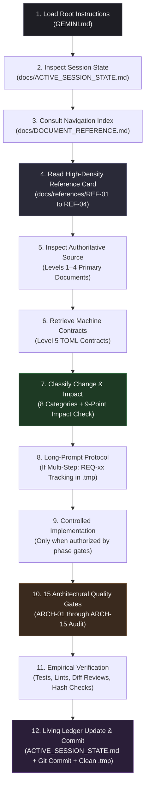

# Binary Sequence Technological Art — Operational Master Blueprint & Development Flow

> **Document Type:** Operational Master Blueprint & Permanent AI Development Flow  
> **Target Audience:** Studio Founders, Systems Architects, Software Engineers, and AI Coding Agents  
> **Canonical Workspace Root:** `G:\binarysequence_techart\`  
> **Status:** Active Operational Master Blueprint (Subordinate to Primary Specifications)  
> **Last Updated:** 2026-10-25  

---

## 1. Foundational Axioms & Guiding Philosophy

Every architectural choice, line of code, technical contract, and documentation update in this repository is anchored to five core principles:

1. **Foundational Proposition:** *"Everyone deserves an enterprise solution."*
2. **Engineering Thesis:** *"Complexity should be absorbed by architecture, not transferred to the user."*
3. **Studio Ethos:** *"Enterprise engineering. Human experience."*
4. **The Precedence Principle:**
   > **Philosophy and approved strategy govern architecture; architecture governs contracts; contracts govern code.**  
   > *Code is evidence of current runtime behavior, not an override of approved requirements.*
5. **The Reuse Principle:**
   > **Reuse should reduce complexity and maintenance—not relocate complexity into a shared abstraction.**

---

## 2. The 6-Level Precedence Hierarchy

Authority in this project is strictly hierarchical. When evaluating requirements, resolving ambiguities, or reviewing changes, higher tiers strictly supersede lower tiers:

```text
┌────────────────────────────────────────────────────────────────────────┐
│ LEVEL 1: FOUNDATIONAL STRATEGY & IDENTITY (Read-only, immutable)       │
│ - initial thought and plan.md                                          │
│ - foundational identity, founder website vision & strategic playbook   │
│ - Binary_Sequence_Technological_Art_Final_Master_v1.1.md               │
└───────────────────────────────────┬────────────────────────────────────┘
                                    │ Governs
                                    ▼
┌────────────────────────────────────────────────────────────────────────┐
│ LEVEL 2: AUDIENCE-FACING CONTENT SPECIFICATIONS                        │
│ - audience_facing_content_specification_v1_1.md                        │
│   (Supersedes Binary_Sequence_Audience_Content_Specification_v1.0.md)  │
└───────────────────────────────────┬────────────────────────────────────┘
                                    │ Dictates
                                    ▼
┌────────────────────────────────────────────────────────────────────────┐
│ LEVEL 3: INFORMATION ARCHITECTURE, VIEWPORT & SENSORY CONTRACTS        │
│ - Binary_Sequence_Information_Architecture_v2.0.md                     │
│ - binary_sequence_screen_layout_ia_motion_loading_contract_final.md    │
└───────────────────────────────────┬────────────────────────────────────┘
                                    │ Informs
                                    ▼
┌────────────────────────────────────────────────────────────────────────┐
│ LEVEL 4: ARCHITECTURAL METHODOLOGY & BOUNDARIES (DDD)                  │
│ - Binary_Sequence_DDD_Architectural_Methodological_Guidelines_v1.0.md  │
│   (Includes Section 16: Engineering Constitution & SOLID Directives)   │
└───────────────────────────────────┬────────────────────────────────────┘
                                    │ Constrains
                                    ▼
┌────────────────────────────────────────────────────────────────────────┐
│ LEVEL 5: MACHINE-READABLE CONTRACTS & SCHEMAS                          │
│ - Approved *.toml contracts & *.schema.json definitions                │
│   (src/**/docs/*.toml, ai_contract_bootstrap/docs/*.toml)              │
└───────────────────────────────────┬────────────────────────────────────┘
                                    │ Verifies
                                    ▼
┌────────────────────────────────────────────────────────────────────────┐
│ LEVEL 6: IMPLEMENTATION & RUNTIME EVIDENCE                             │
│ - Actual source code, test suites, builds, and measured telemetry      │
└────────────────────────────────────────────────────────────────────────┘
```

### The Dual Markdown + TOML Operational Model
* **Markdown (`.md`) is authoritative for human rationale:** Contains strategic context, narrative tone, trade-off evaluations, visual pacing, and editorial nuance.
* **TOML (`.toml`) is authoritative for machine facts:** Contains strict schema versions, context IDs, route tables, state machines, and design tokens (hex values, ms timings, px breakpoints) validated against JSON Schemas (`docs/schemas/*.schema.json`).
* **Rule:** If a TOML file diverges from its governing Markdown specification, the Markdown specification governs, and the TOML contract must be corrected.

---

## 3. Workspace Invariants & Repository Boundaries

1. **Sole Canonical Root:** All operations strictly resolve to [`G:\binarysequence_techart\`](file:///G:/binarysequence_techart/). The former directory `G:\binarysequence_technologicalart` is obsolete and permanently eliminated.
2. **Strict Confinement:** Operations never touch directories, profiles, or drives outside `G:\binarysequence_techart\`.
3. **Git Baseline Discipline:** Branch `main` is the sole integration branch. Every task must leave the working tree in a clean, reviewable state with an evidence-based commit.
4. **No-Unnecessary-Documents Rule:**
   * Update existing authoritative documents in place.
   * Never create parallel summaries that become desynchronized competing sources of truth.
   * Never create versioned duplicates (e.g. `doc_v2.md` alongside `doc_v1.md`) unless authorized as an immutable baseline snapshot.
5. **Preserved Dual Locations:** Existing specifications remain preserved at repository root and in `docs/specifications/` and `src/` without consolidation to avoid breaking references.
6. **No Silent Overwrites:** Level 1 Foundational Strategy documents are immutable and read-only.

---

## 4. The End-to-End AI Development Flow (The Lifecycle Followed Forever)

For every prompt, feature, bug fix, or architecture review, the AI agent executes through this exact sequence:



### Detailed Step-by-Step Breakdown

#### Step 1: Read Root Governance
Read [`GEMINI.md`](file:///G:/binarysequence_techart/GEMINI.md) to load active operational constraints, boundaries, and execution rules.

#### Step 2: Read Living Session State
Read [`docs/ACTIVE_SESSION_STATE.md`](file:///G:/binarysequence_techart/docs/ACTIVE_SESSION_STATE.md) to confirm:
* Active project phase.
* Current approved decisions (`DEC-001` through `DEC-008`).
* Environment tooling status (`DR-02`).
* Recent commit history and handoff directives.

#### Step 3: Consult Master Reference & Index
Consult [`docs/DOCUMENT_REFERENCE.md`](file:///G:/binarysequence_techart/docs/DOCUMENT_REFERENCE.md) or [`docs/discovery/SOURCE_OF_TRUTH_INDEX.md`](file:///G:/binarysequence_techart/docs/discovery/SOURCE_OF_TRUTH_INDEX.md) to locate the exact parent document governing the domain.

#### Step 4: Consult AI-Readable Associative Reference Cards
Read the compact token-efficient reference cards in `docs/references/` to evaluate rules without loading massive prose files:
* [`REF-01`](file:///G:/binarysequence_techart/docs/references/REF-01-FINAL-MASTER-v1.1.md) — Master Strategy Canon (Level 1).
* [`REF-02`](file:///G:/binarysequence_techart/docs/references/REF-02-CONTENT-SPEC-v1.1.md) — Content Spec & Editorial Rules (Level 2).
* [`REF-03`](file:///G:/binarysequence_techart/docs/references/REF-03-IA-AND-LAYOUT-CONTRACT.md) — IA, Viewport, Motion & Loading Contract (Level 3).
* [`REF-04`](file:///G:/binarysequence_techart/docs/references/REF-04-DDD-ARCHITECTURE.md) — DDD Guidelines, SOLID & ARCH Gates (Level 4).

#### Step 5: Inspect Primary Authoritative Documents
When verbatim wording, trade-offs, or precise coordinates matter, inspect the primary document directly:
* Strategy: [`Binary_Sequence_Technological_Art_Final_Master_v1.1.md`](file:///G:/binarysequence_techart/Binary_Sequence_Technological_Art_Final_Master_v1.1.md)
* Content: [`audience_facing_content_specification_v1_1.md`](file:///G:/binarysequence_techart/audience_facing_content_specification_v1_1.md)
* Information Architecture: [`Binary_Sequence_Information_Architecture_v2.0.md`](file:///G:/binarysequence_techart/Binary_Sequence_Information_Architecture_v2.0.md)
* Layout, Sensory & Motion: [`binary_sequence_screen_layout_ia_motion_loading_contract_final.md`](file:///G:/binarysequence_techart/binary_sequence_screen_layout_ia_motion_loading_contract_final.md)
* Architectural Framework: [`Binary_Sequence_DDD_Architectural_Methodological_Guidelines_v1.0.md`](file:///G:/binarysequence_techart/Binary_Sequence_DDD_Architectural_Methodological_Guidelines_v1.0.md)

#### Step 6: Load Bounded Machine Contracts
Load only relevant Level 5 contracts (e.g. `src/app/docs/APP_SHELL_LAYOUT_ROUTING_CONTRACT.toml`, `src/features/home/docs/FEATURE_SPEC.toml`). Unrelated feature contracts are never loaded.

#### Step 7: Mandatory Change Classification
Classify every requested change into one or more of the 8 canonical categories:
* `COMMON`: Alters a shared capability, token, or convention.
* `FEATURE-SPECIFIC`: Bounded strictly to one feature.
* `COMMON + FEATURE-SPECIFIC`: Shared capability change requiring feature adaptations.
* `CROSS-CUTTING`: Impacts architecture, security, performance, or deployment.
* `CLARIFICATION`: Clarifies intent without changing requirements.
* `CORRECTION`: Fixes an error or bug.
* `PROPOSAL`: Awaiting founder sign-off.
* `UNRESOLVED`: Requires external information or credentials.

#### Step 8: Common-to-Feature Dependency Tracing
For every shared change, trace all dependent features:
* Identify the common source of truth.
* Trace every feature that inherits it.
* Update affected features; explicitly verify that unaffected features remain decoupled.

#### Step 9: Long-Prompt & Complex Task Execution Protocol
For multi-step requests:
1. Preserve the full prompt in `.task_<name>.tmp` (automatically git-ignored).
2. Decompose into stable alphanumeric IDs (`REQ-01`, `REQ-02`, etc.).
3. Track each step through the 6-status lifecycle vocabulary:
   `NOT_STARTED` → `IN_PROGRESS` → `BLOCKED` → `AWAITING_APPROVAL` → `COMPLETED` → `VERIFIED`
4. Execute strictly in dependency order.
5. Audit final state against the *complete original prompt*.
6. Delete `.task_<name>.tmp` only after commits and permanent records are verified in Git.

#### Step 10: Controlled Implementation (Within Phase Boundaries)
* If pre-implementation readiness gates (`DR-01` to `DR-10`) are open, **do not write application scaffolding**.
* When implementation is authorized, write focused code conforming strictly to the 4 clean architecture layers.

#### Step 11: Evaluate the 15 Architectural Quality Gates (ARCH-01 through ARCH-15)
Audit every implementation against the 15 Quality Gates established in Section 16 of the DDD Guidelines:
* `ARCH-01 Requirement Traceability`
* `ARCH-02 Domain Integrity`
* `ARCH-03 Separation of Concerns`
* `ARCH-04 SOLID Compliance`
* `ARCH-05 Dependency Direction`
* `ARCH-06 Feature Isolation`
* `ARCH-07 Reuse Audit`
* `ARCH-08 Abstraction Quality`
* `ARCH-09 Shared Component Safety`
* `ARCH-10 Data Ownership`
* `ARCH-11 Error Boundaries`
* `ARCH-12 Testability`
* `ARCH-13 Regression Protection`
* `ARCH-14 Documentation Alignment`
* `ARCH-15 Verification Evidence`

#### Step 12: Empirical Terminal Verification
Never claim completion without terminal proof:
* Run automated linters, test suites, and schema validation scripts.
* Verify 100% path and link integrity.
* Inspect `git diff --stat` to guarantee zero unintended file modifications.

#### Step 13: Living Ledger Handoff & Git Commit
* Update [`docs/ACTIVE_SESSION_STATE.md`](file:///G:/binarysequence_techart/docs/ACTIVE_SESSION_STATE.md) in place with the completed task, active phase, verified evidence, and recommended next steps.
* Commit cleanly to Git with a conventional commit message.
* Safely remove temporary task files.

---

## 5. Engineering Constitution: Architectural Standards & Invariants

Codified in Section 16 of [`Binary_Sequence_DDD_Architectural_Methodological_Guidelines_v1.0.md`](file:///G:/binarysequence_techart/Binary_Sequence_DDD_Architectural_Methodological_Guidelines_v1.0.md):

### 5.1 Domain-Driven Design (4 Layers)
```text
┌────────────────────────────────────────────────────────────────────────┐
│ 4. PRESENTATION LAYER (UI Components, ViewModels, Route Hooks)         │
└───────────────────────────────────┬────────────────────────────────────┘
                                    │ Depends on
                                    ▼
┌────────────────────────────────────────────────────────────────────────┐
│ 3. APPLICATION LAYER (Use Cases, Ports, Orchestration, Gateway DTOs)   │
└───────────────────────────────────┬────────────────────────────────────┘
                                    │ Depends on
                                    ▼
┌────────────────────────────────────────────────────────────────────────┐
│ 2. DOMAIN LAYER (Pure Business Entities, Invariants, Value Objects)     │
│    Zero dependencies on UI, browser APIs, frameworks, or persistence  │
└────────────────────────────────────────────────────────────────────────┘
                                    ▲
                                    │ Implements Ports
┌───────────────────────────────────┴────────────────────────────────────┐
│ 1. INFRASTRUCTURE LAYER (Persistence, Adapters, Network, Framework)    │
└────────────────────────────────────────────────────────────────────────┘
```

### 5.2 Strict Feature Isolation & Public Gateway Discipline
* **Zero Cross-Feature Internal Imports:** `src/features/<feature_a>/` must **never** import internal modules from `src/features/<feature_b>/`.
* **Public Gateway Only:** Cross-feature interactions must use the public gateway exported from `src/features/<feature_b>/index.ts`.
* **Shared Kernel Discipline:** Common shared code lives in `src/core/`. Common code must **never** import from a feature.

### 5.3 SOLID in Concrete Practice
* **S (Single Responsibility):** A repository handles persistence, not UI; a widget renders UI, not business logic; a use case coordinates one workflow.
* **O (Open/Closed):** Extension through slots, composition, and strategy patterns—no speculative plugin frameworks.
* **L (Liskov Substitution):** Subtypes and mocks strictly honor contract semantics, error behaviors, and invariants.
* **I (Interface Segregation):** Narrow, role-specific contracts rather than monolithic "god" interfaces.
* **D (Dependency Inversion):** High-level policy depends on abstractions; concrete implementations are injected at the composition root; zero framework/browser leaks in `domain/`.

### 5.4 Reusable Component Standard (10-Step Evidence-Based Extraction)
1. Identify the recurring requirement in real project work.
2. Inspect existing implementations across features.
3. Determine whether implementations share genuine behavior, not just superficial visual resemblance.
4. Define the stable common contract.
5. Identify legitimate variations.
6. Separate shared presentation behavior from feature-specific domain rules.
7. Author or extend the smallest suitable abstraction.
8. Test the shared component across variants, loading, empty, and error states.
9. Migrate consumers incrementally.
10. Verify that the abstraction reduces total duplication without increasing coupling.
* **Boundary Rule:** UI presentation may be shared, but feature business logic remains within feature boundaries. Shared components in `src/core/` never import feature domain models.

### 5.5 Sequence Core Platform Rules
* Sequence Core is a private, evolving set of reusable engineering foundations across 7 horizontal layers (Engineering Foundations, Identity & Access, Data Infrastructure, Integration, Application Experience, Delivery, Operations).
* **Admission Rule:** A capability enters Sequence Core **only when repeated use in real products demonstrates a measurable, clearly evidenced benefit**.
* Product domain models and business rules remain independently governed.

### 5.6 Prohibited Anti-Patterns
1. Business logic inside UI widgets.
2. Direct persistence/database calls from presentation components.
3. Framework/browser imports inside the domain layer.
4. Monolithic "god" classes or universal repositories.
5. Speculative base classes or single-use interfaces without boundary benefits.
6. Cross-feature internal imports bypassing public gateways.
7. Feature business logic inside shared UI components.
8. Global mutable state shortcuts.
9. Premature extraction into Sequence Core.
10. Unnecessary layers for simple static presentation changes.

---

## 6. Current Repository Status & Next Implementation Actions

### Current State
* **Repository Baseline:** Clean on branch `main`.
* **Phase:** Phase 0 Complete ➔ Phase 1 Preparation.
* **Governance Status:** 100% documented, indexed, validated, and committed.

### Open Pre-Flight Gates Awaiting Founder Action
Before Phase 1 application code scaffolding begins, four decisions/actions must be resolved:

1. **Host Tooling Path (`DR-02`):**  
   * *Status:* `BLOCKED (Environment)`  
   * *Action:* Expose Node.js and pnpm in the system PATH so terminal commands (`node -v`, `pnpm -v`) succeed.
2. **Technology Stack Sign-Off (`DR-03` / `DEC-006`):**  
   * *Status:* `PROPOSED / AWAITING_APPROVAL`  
   * *Action:* Founder formal sign-off on Astro + TypeScript + CSS via Engineering Decision Record (`EDR-001`).
3. **Launch Scope Sign-Off (`DR-04` / `DEC-005`):**  
   * *Status:* `PROPOSED / AWAITING_APPROVAL`  
   * *Action:* Founder formal sign-off on direct landing on Home hero for V1 launch (deferring or scoping Onboarding Gate `FEAT-01-ONB`).
4. **Contact Form Intake Backend (`DR-08`):**  
   * *Status:* `PENDING_DECISION`  
   * *Action:* Founder selection of intake backend mechanism (custom API, Formspree, Resend, or simple `mailto:`).

---

## 7. Permanent Binding Commitment

This operational flow, precedence hierarchy, retrieval sequence, engineering constitution, and evidence-based verification standard are permanently codified in the workspace. Every task executed in this repository will adhere strictly to this framework.
